# 1. Введение

Цель работы — выбрать прикладную задачу, для которой многоагентный подход естественен, формально описать многоагентную систему (МАС) для её решения, построить диаграмму ролей и граф коммуникаций и обосновать выбор архитектуры. Архитектура должна подходить для следующих работ курса: ЛР2 (сравнение механизмов распределения задач), ЛР3 (переговоры и разрешение конфликтов при дефиците ресурса) и ЛР4 (диверсионные сценарии и защиты).

Что сделано:

- выбрана задача городской доставки «последней мили» группой автономных курьеров-роботов двух типов, которые делят ограниченную зарядную инфраструктуру;
- спецификация МАС записана в двух формах: машиночитаемой (роли, протоколы и таблица полномочий в модуле ядра `roles.py`) и описательной (этот отчёт: схемы ролей в стиле методологии Gaia, модель сообщений, протоколы с пред- и постусловиями, тайм-аутами и правилами отказа);
- система реализована как ядро `lab1/mas` на Python без готовых МАС-фреймворков. Логика агентов, правила координации и переговоров записаны в явной форме, механизмы ЛР2–ЛР4 подключаются как режимы работы без изменения ядра;
- скрипт `lab1/docs/make_figures.py` строит 11 рисунков: среду, диаграмму ролей, проектный и наблюдаемый графы коммуникаций, диаграммы состояний и последовательностей, схему архитектуры, диаграмму занятости флота;
- выполнен базовый прогон на 30 значениях seed. Таблица показателей `lab1/results/baseline.csv` — точка отсчёта для ЛР2–ЛР4.

Все числа в отчёте получены прогонами ядра (`Simulation`, `experiment.run_batch`) и воспроизводятся командой `python lab1/docs/make_figures.py`.

# 2. Прикладная задача

## 2.1. Содержательное описание

Район города обслуживает флот автономных роботов-курьеров. Заказы появляются в случайные моменты в точках выдачи (склады, рестораны) и должны быть доставлены по адресу к сроку. Заказы различаются весом (лёгкие — до 4,5 кг, тяжёлые — от 6 до 18 кг), срочностью (обычные и срочные с более жёстким сроком) и вознаграждением. Курьеры бывают двух типов: лёгкие (грузоподъёмность 5 кг, батарея 100 условных единиц) и тяжёлые (20 кг, 160 единиц). Тяжёлый курьер тратит больше энергии на шаг. Зарядиться можно только на зарядных станциях, где мало мест; дополнительно может действовать общий лимит мощности сети. Курьер, разрядившийся в пути, выбывает до эвакуации.

Нужно решить, какой курьер берёт какой заказ, в каком порядке выполняет принятые заказы, когда и на какой станции заряжается, — так, чтобы как можно больше заказов было доставлено в срок при разумных затратах энергии и координации.

## 2.2. Почему многоагентная система

- **Распределённость.** Исполнители разнесены по городу; каждый точно знает только своё положение и заряд. Центр видит курьеров через периодическую телеметрию, которая приходит с задержкой и устаревает.
- **Автономность.** Робот сам отвечает за свою безопасность (не разрядиться), может отказаться от невыполнимого заказа, сам выбирает момент и станцию зарядки.
- **Разные интересы.** В рыночных механизмах (ЛР2) курьеры стремятся к своему доходу, на станциях (ЛР3) конкурируют за места. Это естественно описывается агентами с собственными целями.
- **Масштабируемость и устойчивость.** Курьеров можно добавлять без перестройки системы. Потеря связи с одним курьером не останавливает работу: сторожевой таймер возвращает его заказы в распределение.
- **Открытость.** Протоколы явные, поэтому можно заменить механизм распределения или политику станции, добавить нового агента (арбитра) или злоумышленника (ЛР4), не меняя остальных участников.

## 2.3. Формальная постановка

**Пространство и время.** Город — сетка G = {0, …, W−1} × {0, …, H−1}, в базовом режиме W = H = 20. Расстояние манхэттенское: d(a, b) = |a.x − b.x| + |a.y − b.y|. Время дискретно (такты t = 0, 1, 2, …); за такт курьер сдвигается не более чем на одну клетку.

**Объекты среды.**

- Точки выдачи P ⊂ G, |P| = 4: (4, 4), (15, 4), (4, 15), (15, 15).
- Станции S, |S| = M = 2: station-1 в (10, 2) и station-2 в (10, 17). У станции s есть m(s) = 2 места и скорость зарядки ρ = 10 единиц за такт. Может быть задан общий лимит одновременно заряжающихся курьеров P_max (параметр `grid_power_limit`, в базовом режиме не задан).
- Курьеры K, |K| = N = 8. Курьер k имеет тип θ(k) ∈ {light, heavy}, грузоподъёмность Q(k), ёмкость батареи B(k), расход энергии на шаг без груза α(k) и с грузом β(k) (таблица 1). Состояние курьера в такт t — положение x(k, t) ∈ G, заряд b(k, t) ∈ [0, B(k)], очередь принятых заказов и признак груза на борту.
- Заказы O = {o1, …, on}, n = 60. Заказ o = ⟨p(o), q(o), w(o), π(o), c(o), τ(o), r(o)⟩: точка забора p(o) ∈ P, точка доставки q(o) ∈ G, вес w(o), приоритет π(o) ∈ {normal, urgent}, момент появления c(o), срок τ(o), вознаграждение r(o).

Таблица 1 — Типы курьеров

| Тип | Q, кг | B, усл. ед. | α (шаг без груза) | β (шаг с грузом) | В базовом флоте |
|---|---:|---:|---:|---:|---:|
| light | 5 | 100 | 1,0 | 1,3 | 6 |
| heavy | 20 | 160 | 1,4 | 1,8 | 2 |

**Поток заказов.** Моменты появления образуют пуассоновский поток с интенсивностью λ = 0,2 заказа за такт. Точка забора выбирается равновероятно из P, точка доставки — равновероятно среди клеток с d(p(o), q(o)) ≥ 3. С вероятностью 0,2 заказ тяжёлый (вес равномерно в [6; 18] кг), иначе лёгкий (в [0,5; 4,5] кг); независимо с вероятностью 0,2 заказ срочный. Обозначим длину поездки ℓ(o) = d(p(o), q(o)). Срок: τ(o) = c(o) + ⌊25 + 1,5·ℓ(o)⌋ для срочного заказа и τ(o) = c(o) + ⌊60 + 2,5·ℓ(o)⌋ для обычного. Вознаграждение: r(o) = (10 + 0,5·ℓ(o))·u(o)·h(o), где u(o) = 1,5 для срочного заказа и 1 для обычного, h(o) = 1,3 для тяжёлого и 1 для лёгкого. Поток зависит только от seed, поэтому при одинаковом seed все режимы работы получают одинаковые заказы (метод общих случайных чисел для честного сравнения в ЛР2–ЛР4).

**Ограничения.**

1. Грузоподъёмность: заказ o может исполнять только курьер с w(o) ≤ Q(k).
2. Энергия: шаг без груза стоит α(k), с грузом — β(k). Шаг возможен, только если заряд не меньше его стоимости; иначе курьер разряжается в пути (stranded) и выбывает на 40 тактов, после чего эвакуируется на ближайшую станцию с зарядом 0,5·B(k).
3. Резерв: курьер планирует работу так, чтобы после заказа и пути до ближайшей станции оставалось не менее 0,1·B(k).
4. Вместимость: на борту не более одной посылки, заказы выполняются по очереди.
5. Операции с посылкой: забрать её можно только в p(o) и только пока она ждёт; доставить — только в q(o) и только курьеру, у которого она на борту.
6. Станции: на станции s одновременно заряжаются не более m(s) курьеров, и только те, кто стоит на станции. При заданном P_max суммарное число заряжающихся по сети не должно его превышать. Соблюдение лимита мощности — задача механизмов ЛР3; ядро лишь считает такты превышения.

**Критерии.** Задача многокритериальная, ядро не сворачивает критерии в один скаляр:

- доля заказов, доставленных в срок: F = |{o : t_дост(o) ≤ τ(o)}| / n → max, отдельно для срочных заказов;
- среднее время доставки T_ср = среднее по доставленным заказам (t_дост(o) − c(o)) и его 95-й перцентиль → min;
- суммарный пробег и суммарная энергия E → min;
- стоимость координации: число и объём сообщений, процессорное время механизма распределения → min;
- справедливость (важна в ЛР2–ЛР3): индекс Джайна J(x) = (Σ x_k)² / (N·Σ x_k²) по числу заказов, доходу и ожиданию зарядки (J = 1 — полное равенство, 1/N — всё у одного);
- соблюдение ограничений: число разрядок в пути и тактов с превышением лимита мощности.

## 2.4. Допущения модели

- Движение по сетке без препятствий и пробок со скоростью 1 клетка за такт; маршрут строится жадно, шаг делается по оси с большим остатком пути.
- Погрузка и выгрузка мгновенны, в такт прибытия.
- Зарядка линейная (+10 единиц за такт); базовая стратегия заряжает, пока заряд не достигнет 95 % ёмкости.
- Связь асинхронная, с фиксированной задержкой 1 такт. В штатном режиме сообщения не теряются; теряются только сообщения недоступному получателю (или вводятся сценариями ЛР4).
- Все заказы публикует один агент-клиент (шлюз); клиент не отменяет заказы.
- Курьер без заказов стоит на месте: перебалансировки флота нет.
- Истинное положение посылок хранит среда. Агенты узнают его только через свои действия и сообщения.

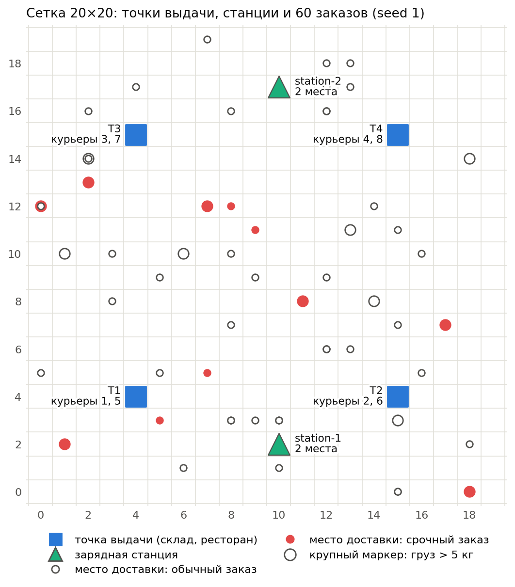

# 3. Формальное описание МАС

## 3.1. МАС как кортеж

MAS = ⟨Env, Ag, R, Π, M, Org⟩, где:

- Env = ⟨G, P, S, O, Φ⟩ — среда: сетка, точки выдачи, станции, поток заказов и физика Φ (движение, расход и пополнение энергии, забор и доставка посылки, эвакуация);
- Ag — множество агентов: клиент, диспетчер, N курьеров и M станций (в базовом режиме 1 + 1 + 8 + 2 = 12 агентов); отображение role: Ag → R назначает каждому агенту ровно одну роль;
- R = {client, dispatcher, courier, station} — роли (раздел 3.3);
- Π = {order, assign, order-status, telemetry, charge} — протоколы; Perm ⊆ R × R × Π × Perf — таблица полномочий: какие перформативы Perf роль-отправитель может посылать роли-получателю в каждом протоколе (раздел 3.5);
- M — модель сообщений и канал связи (раздел 3.4);
- Org — организационная структура: подчинение, обслуживание, а в ЛР2–ЛР3 также рыночные и одноранговые отношения (раздел 3.6).

Агент a описывается как ⟨id, role, B_a, S_a, A_a, Plug_a⟩: знания (убеждения) B_a, внутреннее состояние S_a, действия A_a и список подключаемых модулей поведения Plug_a. Цикл агента в такт t одинаков для всех ролей:

1. взять сообщения, доставленные к такту t;
2. предложить каждое сообщение подключаемым модулям по порядку; первый, кто принял сообщение, его поглощает;
3. непоглощённые сообщения обрабатывает базовое поведение роли;
4. выполнить шаг каждого модуля;
5. выполнить собственное действие роли (движение, контроль, зарядка и т. д.).

Агенты ходят в фиксированном порядке: клиент, диспетчер, станции, курьеры. Порядок такта системы: внешние обработчики начала такта (сбои, расписания), доставка созревших сообщений, шаги агентов, учёт показателей, обработчики конца такта, кадр для веб-демонстрации.

## 3.2. Свойства среды

Таблица 2 — Свойства среды

| Свойство | Значение в модели |
|---|---|
| Наблюдаемость | Частичная. Курьер знает своё положение и заряд, карту станций и точек выдачи. Диспетчер видит курьеров только через телеметрию (период 5 тактов, задержка 1 такт) и через свои назначения, поэтому его убеждения устаревают |
| Детерминизм | Физика детерминирована. Поток заказов стохастичен (пуассоновский), но полностью задаётся seed |
| Эпизодичность | Последовательная среда: решения влияют на будущее (очереди заказов, заряд, занятость станций) |
| Динамичность | Динамическая: заказы появляются, пока агенты действуют |
| Дискретность | Дискретные время (такты), пространство (клетки), действия и сообщения |
| Число агентов | Многоагентная. В ядре агенты кооперативны (общая цель — доставка); в ЛР2–ЛР3 появляются конкурентные интересы (доход курьеров, общий дефицитный ресурс) |
| Известность правил | Правила физики известны агентам: расход энергии, скорость зарядки, координаты станций |

## 3.3. Роли: цели, знания, состояния, действия, полномочия, средства

Роли описаны в форме схем ролей Gaia. Машиночитаемая часть (цели, знания, действия, полномочия, средства) записана в `roles.ROLES` и используется для построения диаграммы ролей (раздел 4). Обязанности живучести (liveness) записаны выражениями, где «.» — последовательность, «|» — выбор, «+» — повторение один или более раз, «ω» — бесконечное повторение, «[x]» — необязательный шаг, «∥» — параллельное выполнение. Обязанности безопасности (safety) — инварианты, которые роль не нарушает.

### 3.3.1. Клиент (client)

Таблица 3 — Схема роли «Клиент»

| Атрибут | Содержание |
|---|---|
| Назначение | Шлюз заказов: публикует заказы города в момент их появления и принимает подтверждения доставки |
| Цели | Получить доставку каждого заказа к сроку |
| Знания | Свои заказы (расписание по моменту появления): места забора и доставки, вес, приоритет, срок, вознаграждение, свободный текст заметки |
| Состояние | Номер следующего заказа в расписании; подтверждённые доставки |
| Действия | Опубликовать заказ: поместить посылку в среду в состоянии «ждёт» и отправить диспетчеру REQUEST order; принять подтверждение приёма (AGREE) и уведомление о доставке (INFORM) |
| Протоколы | order — инициатор; order-status — получатель |
| Полномочия | Создавать заказы от своего имени |
| Средства | Канал связи с диспетчером |

- Живучесть: CLIENT = (PublishOrder . ReceiveAck)+ ∥ (ReceiveDelivered)ω.
- Безопасность: каждый заказ публикуется ровно один раз и не раньше момента c(o).

### 3.3.2. Диспетчер (dispatcher)

Таблица 4 — Схема роли «Диспетчер»

| Атрибут | Содержание |
|---|---|
| Назначение | Ведёт книгу заказов, распределяет заказы (механизм подключается), контролирует исполнение, уведомляет клиента |
| Цели | Доставить все заказы; максимизировать долю доставок в срок; минимизировать простои и затраты на координацию |
| Знания (убеждения) | Книга заказов: для каждого заказа статус, исполнитель, такт последней смены статуса, множество отказавшихся курьеров, такт последнего отказа, число передач между исполнителями. Убеждения о каждом курьере: априорно — тип, грузоподъёмность, ёмкость и расход; по телеметрии — положение, заряд, состояние, список заказов, «хвост» маршрута (где, когда и с каким зарядом курьер освободится), такт последнего сообщения, признак потери связи |
| Состояние | Статусы заказов в книге: pending, announced, assigning, assigned, picked, delivered (рисунок 6) |
| Действия | Принять заказ (AGREE клиенту); выбрать исполнителя (подключаемый механизм); назначить (REQUEST assign); подтвердить назначение; отозвать (CANCEL); вернуть заказ в распределение (release); обновить убеждения; обнаружить потерю связи; уведомить клиента о доставке |
| Протоколы | order — участник; assign — инициатор; order-status — получатель от курьера и инициатор к клиенту; telemetry — получатель |
| Полномочия | Назначать и отзывать заказы у курьеров; подтверждать доставку клиенту. Диспетчер не перемещает посылки и не управляет движением курьеров |
| Средства | Канал связи со всеми курьерами и клиентом; сторожевой таймер; подключаемый механизм распределения |

- Живучесть: DISPATCHER = (AcceptOrder | Allocate | HandleReply | UpdateBeliefs | Watchdog | NotifyClient)ω; для отдельного заказа: AcceptOrder . (Assign . (Confirm | Release))+ . MarkPicked . MarkDelivered . NotifyClient.
- Безопасность: у заказа в книге не более одного исполнителя; заказ назначается только курьеру, который не помечен потерянным, по убеждениям способен поднять груз и не отказывался от этого заказа в последние 10 тактов; заказ не остаётся в статусе assigning дольше 8 тактов (assign_timeout + 2·msg_latency); клиент уведомляется о доставке только после сообщения курьера о доставке.

**Базовый механизм распределения** (режим `central`, централизованная диспетчеризация). Каждый такт диспетчер просматривает заказы в статусе pending в порядке «сначала срочные, затем по сроку, затем по моменту появления» и для каждого выбирает курьера с минимальной оценкой времени завершения по своим убеждениям:

ETA(k, o) = max(t, tail_eta(k)) + d(tail_pos(k), p(o)) + ℓ(o) + штраф(k, o),

где штраф равен (B(k) − max(0, tail_battery(k))) / ρ + 6 тактов, если после заказа заряд курьера опустился бы ниже резерва 0,1·B(k), и нулю иначе. При равенстве оценок выбирается курьер с меньшим номером. Сразу после назначения диспетчер «продлевает» хвост маршрута курьера в своих убеждениях (новое положение — q(o), время — ETA, заряд уменьшен на энергию заказа), не дожидаясь следующей телеметрии.

### 3.3.3. Курьер (courier)

Таблица 5 — Схема роли «Курьер»

| Атрибут | Содержание |
|---|---|
| Назначение | Автономный робот-доставщик |
| Цели | Выполнить принятые заказы; не разрядиться в пути; в ЛР2–ЛР3 — максимизировать свой доход |
| Знания | Своё положение, заряд, тип, грузоподъёмность, расход энергии; очередь принятых заказов, текущий заказ и признак груза на борту; карта точек выдачи и станций; станции, недавно отказавшие в зарядке (помнит 50 тактов) |
| Состояние | idle, to_pickup, to_dropoff, to_station, waiting_charge, charging, stranded (рисунок 5) |
| Действия | Принять или отклонить заказ; снять незабранный заказ по CANCEL; сделать шаг; забрать и доставить посылку (действия над средой); сообщить о заборе и доставке (INFORM) или о невозможности исполнения (FAILURE); решить ехать на зарядку и выбрать станцию; запросить место; закончить зарядку; отправлять телеметрию; после эвакуации вернуть незабранные заказы |
| Протоколы | assign — участник; order-status — инициатор; telemetry — инициатор; charge — инициатор |
| Полномочия | Решать, принимать ли заказ; выбирать станцию и момент зарядки; управлять своим движением. Курьер не назначает заказы другим и не отменяет чужие назначения |
| Средства | Двигатель и батарея; грузовой отсек на одну посылку; канал связи с диспетчером и станциями |

**Правило приёма заказа.** Курьер соглашается (AGREE), если w(o) ≤ Q(k) и «плечо» «станция → забор → доставка → станция» укладывается в батарею с резервом:

α(k)·d(s(p(o)), p(o)) + β(k)·ℓ(o) + α(k)·d(q(o), s(q(o))) ≤ 0,9·B(k),

где s(x) — ближайшая к точке x станция. Иначе курьер отвечает REFUSE с причиной payload или range. Текущий заряд при приёме не учитывается: нехватку энергии курьер устраняет зарядкой. Принятый заказ ставится в конец очереди.

**Правило зарядки** (базовая стратегия `naive`). Если заряд не ниже 95 % ёмкости, заряжаться не нужно. Если заказов нет, курьер едет заряжаться при заряде ниже 40 %. Иначе — если заряд минус энергия на текущий (или следующий) заказ и путь от его точки доставки до ближайшей станции меньше резерва 0,1·B(k). Выбирается ближайшая станция, кроме отказавших за последние 50 тактов. Зарядка заканчивается, когда заряд достигает 95 % ёмкости.

- Живучесть: COURIER = (HandleAssign | Work | ChargeCycle | Telemetry)ω, где Work = Step+ . Pickup . InformPicked . Step+ . Deliver . InformDelivered, ChargeCycle = GoCharge . Step+ . RequestCharge . [Queued] . Charging+ . InformDone; Telemetry выполняется каждые 5 тактов во всех состояниях, кроме stranded.
- Безопасность: вес любого принятого заказа не больше грузоподъёмности; заряд не уходит в минус (шаг делается только при достаточном заряде, иначе курьер переходит в stranded); на борту не более одной посылки; забранный заказ по CANCEL не снимается; потребность в зарядке проверяется каждый такт до движения.

### 3.3.4. Зарядная станция (station)

Таблица 6 — Схема роли «Зарядная станция»

| Атрибут | Содержание |
|---|---|
| Назначение | Распоряжается ограниченным ресурсом — местами зарядки |
| Цели | Обслужить курьеров без превышения числа мест; в ЛР3 — соблюдать лимит мощности сети |
| Знания | Свои координаты, число мест, скорость зарядки; занятые места (курьер и такт начала); очередь ожидания; признак доступности |
| Состояние | Число занятых мест и длина очереди |
| Действия | Выделить место (AGREE); поставить в очередь (INFORM queued); отказать (REFUSE: станция недоступна или курьер не на станции); освободить место (по INFORM done, CANCEL или уходу курьера); заряжать (+ρ за такт каждому на месте, не выше ёмкости) |
| Протоколы | charge — участник |
| Полномочия | Распоряжаться своими местами; политика допуска подключается, базовая — FIFO |
| Средства | m(s) мест зарядки; канал связи с курьерами |

- Живучесть: STATION = (HandleRequest | AdmitFromQueue | Charge | FreeSlot)ω.
- Безопасность: занятых мест не больше m(s); место получает только курьер, стоящий на станции; очередь обслуживается в порядке прибытия; заряд не превышает ёмкости.

## 3.4. Модель сообщений и каналы связи

Сообщения — подмножество языка FIPA-ACL (таблица 7).

Таблица 7 — Поля сообщения

| Поле | Смысл |
|---|---|
| id, t | номер, присвоенный шиной, и такт отправки |
| sender | заявленный отправитель (агент может указать любое имя) |
| receiver | получатель — один агент; широковещание выполняется серией адресных сообщений всем агентам роли |
| perf | перформатив |
| protocol | протокол взаимодействия |
| content | содержание (словарь; для заказа — все его поля) |
| conv, reply_to | идентификатор диалога (обычно id заказа) и номер сообщения, на которое дан ответ |
| origin | истинный отправитель, известный только шине (модель подписи сообщений для ЛР4) |
| delay | дополнительная задержка, которую вносят сбои канала (ЛР4) |

Перформативы REQUEST, AGREE, REFUSE, INFORM, FAILURE, CANCEL используются ядром; CFP, PROPOSE, ACCEPT-PROPOSAL, REJECT-PROPOSAL и QUERY зарезервированы для механизмов ЛР2–ЛР3.

**Канал.** Шина сообщений — единственное средство связи между агентами. Сообщение, отправленное в такт t, доставляется в начале такта t + L + delay, где L = msg_latency = 1; сообщения с одинаковым временем доставляются в порядке номеров. Если получатель недоступен (выключен или разрядился в пути), сообщение теряется и учитывается как потерянное. Перед постановкой в очередь сообщение проходит цепочку промежуточных обработчиков шины, которые могут его изменить, размножить или заблокировать; это точка подключения сбоев, атак и защит. Каждое сообщение учитывается в показателях (по перформативам, протоколам, парам ролей; объём — длина содержимого в JSON плюс 32 байта заголовка) и записывается в трассу. Физические действия (движение, забор, доставка, зарядка) выполняются через среду, а не через шину.

**Каналы базового режима:** клиент ↔ диспетчер; диспетчер ↔ каждый курьер (звезда); курьер ↔ каждая станция. Прямых каналов «курьер ↔ курьер» и «станция ↔ диспетчер» в ядре нет; их открывают механизмы ЛР2 (делегирование) и ЛР3 (арбитр), дополняя таблицу полномочий.

**Временная семантика.** Ответ на запрос приходит не раньше чем через 2L тактов. Цепочка «клиент публикует заказ → диспетчер назначает → курьер соглашается → диспетчер фиксирует назначение» занимает 3L = 3 такта.

## 3.5. Протоколы и правила взаимодействия

Таблица 8 — Протоколы ядра

| Протокол | Участники и сообщения | Предусловие | Постусловие | Тайм-ауты, отказ, отзыв |
|---|---|---|---|---|
| order | клиент → диспетчер: REQUEST {заказ}; ответ AGREE {order_id} | наступил момент появления заказа | заказ в книге в статусе pending; повторный id игнорируется | REFUSE разрешён таблицей полномочий, но ядром не используется |
| assign | диспетчер → курьер: REQUEST {заказ}; ответ AGREE {order_id} или REFUSE {order_id, reason}; позже возможны CANCEL от диспетчера и FAILURE {order_id, reason} от курьера | заказ pending; курьер не потерян, способен поднять груз и не отказывался от заказа последние 10 тактов | AGREE: заказ в очереди курьера, статус assigned; REFUSE: статус pending, курьер в списке отказавших | нет ответа дольше 8 тактов — CANCEL и возврат в pending; опоздавший AGREE не-исполнителя — CANCEL; FAILURE исполнителя (already-taken, wrong-place, unknown-order, released) — возврат в pending |
| order-status | курьер → диспетчер: INFORM {picked} и INFORM {delivered}; диспетчер → клиент: INFORM {delivered, courier} | забор или доставка в среде прошли успешно | статус picked, затем delivered; клиент уведомлён | — |
| telemetry | курьер → диспетчер: INFORM {pos, battery, state, tasks, tail_pos, tail_eta, tail_battery, carrying} каждые 5 тактов | курьер не в состоянии stranded | убеждения обновлены, такт последнего контакта сброшен | молчание дольше 25 тактов — курьер помечается потерянным, его заказы в assigning и assigned отзываются CANCEL и возвращаются в pending |
| charge | курьер → станция: REQUEST {battery, capacity} по прибытии; ответ AGREE {granted}, INFORM {queued: позиция} или REFUSE {reason}; позже AGREE из очереди; по окончании INFORM {event: done} или CANCEL | курьер стоит на станции | место выделено или курьер в очереди; после done место освобождено | REFUSE — курьер едет на другую станцию (отказавшую помнит 50 тактов) или становится свободным; уход курьера со станции освобождает место |

Таблица 9 — Таблица полномочий Perm (`roles.PERMISSIONS`, ядро ЛР1)

| Роль-отправитель | Роль-получатель | Протокол | Разрешённые перформативы |
|---|---|---|---|
| client | dispatcher | order | REQUEST |
| dispatcher | client | order | AGREE, REFUSE |
| dispatcher | client | order-status | INFORM |
| dispatcher | courier | assign | REQUEST, CANCEL |
| courier | dispatcher | assign | AGREE, REFUSE, FAILURE |
| courier | dispatcher | telemetry | INFORM |
| courier | dispatcher | order-status | INFORM |
| courier | station | charge | REQUEST, INFORM, CANCEL |
| station | courier | charge | AGREE, REFUSE, INFORM |

В ядре таблица полномочий — спецификация; агенты по ней сообщения не фильтруют. Проверка полномочий — защитный механизм ЛР4 (`roles.is_allowed`). Механизмы ЛР2–ЛР3 дополняют таблицу своими протоколами.

Общие правила взаимодействия:

- **Идемпотентность.** Повторный REQUEST order с тем же id игнорируется; курьер не добавляет в очередь уже принятый заказ.
- **Опоздавшие ответы.** AGREE от курьера, который уже не исполнитель заказа, диспетчер отзывает сообщением CANCEL; REFUSE и FAILURE от не-исполнителя игнорируются.
- **Признак жизни.** Любое сообщение курьера обновляет такт последнего контакта в убеждениях диспетчера и снимает пометку «потерян».
- **Отзыв.** CANCEL снимает только незабранный заказ; забранная посылка остаётся у курьера.
- **Доверие к уведомлениям.** Сообщения о заборе и доставке диспетчер принимает от того, кто указан отправителем, не сверяя его с исполнителем. Это сознательное упрощение базового режима, исследуемое как уязвимость в ЛР4.

## 3.6. Организационная структура

- **Иерархия с автономными исполнителями: диспетчер — курьеры (1 : N).** Диспетчер вправе назначать и отзывать заказы, но курьер может отказаться, сам управляет движением и зарядкой. Это организация базового режима `central`.
- **Обслуживание: станция — курьер (M : N).** Станция распоряжается своим ресурсом, курьер выступает её клиентом.
- **Заказчик — посредник: клиент — диспетчер.**
- **Рыночные отношения (ЛР2).** В контрактной сети и аукционе диспетчер становится менеджером или аукционистом, курьеры — подрядчиками или участниками торгов со своей целью «доход»; на время торгов заказ получает статус announced.
- **Одноранговые отношения (ЛР2).** При делегировании курьеры передают заказы друг другу.
- **Арбитраж (ЛР3).** Новая роль — энергокоординатор сети — выдаёт станциям разрешения на мощность и разрешает конфликты по приоритету.

# 4. Диаграмма ролей

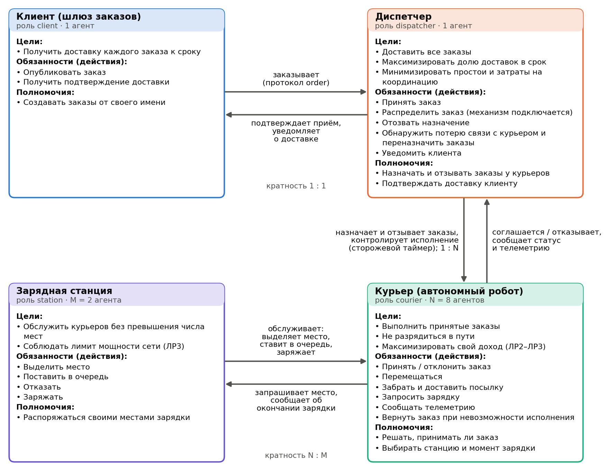

Диаграмма (рисунок 2) построена автоматически из машиночитаемой спецификации `roles.ROLES`, поэтому совпадает с тем, что заложено в ядро. Для каждой роли показаны цели, обязанности (действия), полномочия и число агентов в базовом режиме. Связи ролей:

- клиент **заказывает** у диспетчера; диспетчер **подтверждает** приём и **уведомляет** о доставке (1 : 1);
- диспетчер **назначает и отзывает** заказы и **контролирует** исполнение сторожевым таймером; курьер **соглашается или отказывается** и **сообщает** статус и телеметрию (1 : N);
- станция **обслуживает** курьеров — выделяет место, ставит в очередь, заряжает; курьер **запрашивает** место и **сообщает** об окончании зарядки (N : M).

Роль курьера — единственная, у которой цели могут противоречить системным: «максимизировать свой доход» (ЛР2–ЛР3) не совпадает с целью диспетчера «доставить всё в срок». Роль станции содержит цель «соблюдать лимит мощности», которую базовый режим не выполняет, — это конфликт, который решается в ЛР3.

# 5. Граф коммуникаций

## 5.1. Проектный граф

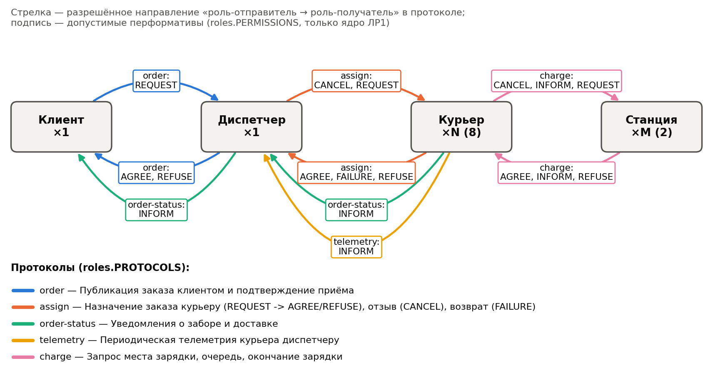

Узлы проектного графа (рисунок 3) — роли, дуги — разрешённые направления сообщений в каждом протоколе, подписи дуг — допустимые перформативы. Граф построен из таблицы `roles.PERMISSIONS` (таблица 9). Топология — цепочка «клиент — диспетчер — курьеры — станции» с центром в диспетчере: в базовом режиме диспетчер — единственный узел, связанный со всеми курьерами, и через него проходит весь поток заказов. Девять направленных связей покрывают пять протоколов. Самая насыщенная пара — «курьер → диспетчер»: по ней идут ответы на назначения, уведомления о статусе и телеметрия.

## 5.2. Наблюдаемый граф и структура трафика

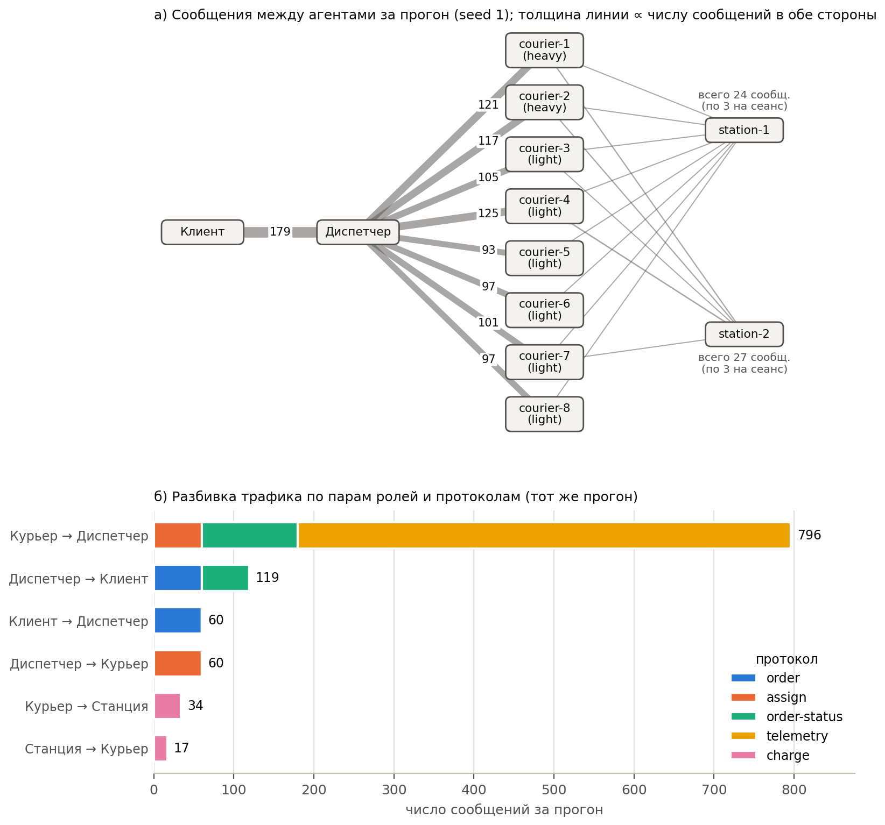

Наблюдаемый граф (рисунок 4) построен по трассе реального прогона: вес ребра — число сообщений между агентами в обе стороны. В прогоне seed 1 было 1086 сообщений; 796 из них (73 %) — от курьеров к диспетчеру, и 616 из этих 796 — телеметрия. Трафик курьер ↔ диспетчер распределён неравномерно (от 93 до 125 сообщений на курьера), потому что неравномерно распределены заказы (подробнее в разделе 9). Курьеры общаются со станциями мало: 51 сообщение за 17 сеансов зарядки, по 3 на сеанс.

Средние по 30 прогонам приведены в таблице 10.

Таблица 10 — Структура трафика базового режима (30 прогонов, seed 1–30)

| Протокол | Сообщений за прогон (среднее ± 95 % ДИ) | Доля, % | На заказ |
|---|---:|---:|---:|
| order | 120 ± 0 | 11,5 | 2,0 |
| assign | 120 ± 0 | 11,5 | 2,0 |
| order-status | 179,0 ± 0,1 | 17,1 | 3,0 |
| telemetry | 570,1 ± 19,3 | 54,4 | 9,5 |
| charge | 58,8 ± 2,0 | 5,6 | 1,0 |
| Всего | 1047,9 ± 19,0 | 100 | 17,5 |

По перформативам в базовом режиме встречаются только REQUEST (139,5 за прогон), AGREE (139,5) и INFORM (769,0); отказов, отзывов и сообщений о сбоях нет. Средний объём сообщения — 142,6 байта, за прогон — 149 482 ± 3 271 байт.

Из протоколов следует оценка числа сообщений за прогон: M ≈ 7·n + N·⌈T/5⌉ + 3·S + Q. Здесь 7 сообщений на заказ — это 2 в order, 2 в assign и 3 в order-status; N·⌈T/5⌉ — телеметрия N курьеров за T тактов; S — число сеансов зарядки (REQUEST, AGREE, INFORM done); Q — число постановок в очередь. Во всех 30 прогонах фактическое число сообщений меньше оценки на 1–3 (на 1 — в 22 прогонах, на 2 — в 6, на 3 — в 2). Причина в том, что прогон заканчивается в такт физической доставки последней посылки: последние уведомления клиенту и сообщения об окончании незавершённых сеансов зарядки отправить не успевают. Вывод для ЛР2: в базовом режиме больше половины трафика — мониторинг (телеметрия), а собственно распределение стоит 4 сообщения на заказ. Механизмы с переговорами будут увеличивать именно эту часть, и сравнивать их нужно по сообщениям протоколов распределения отдельно от мониторинга.

# 6. Диаграммы состояний и сценарии взаимодействия

## 6.1. Состояния курьера

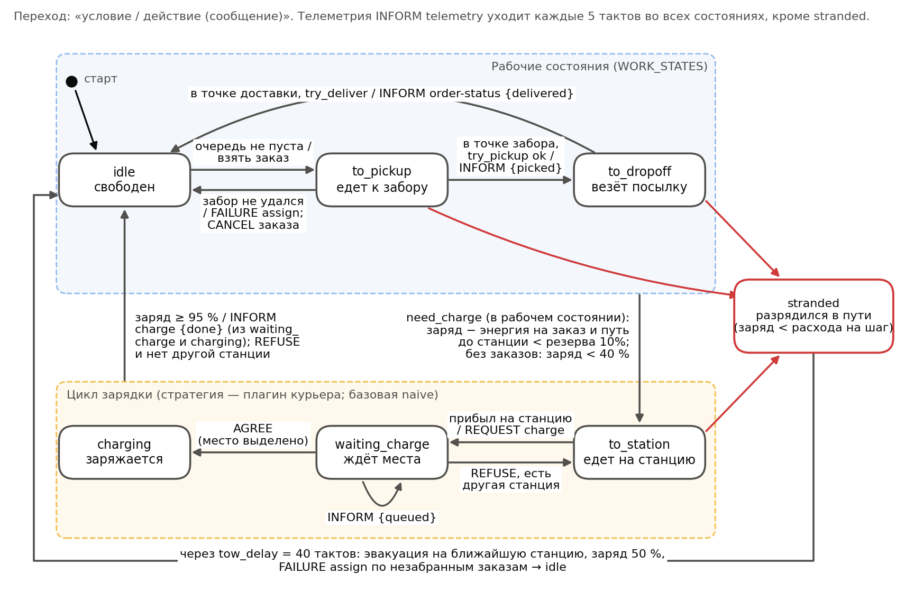

Курьер имеет семь состояний (рисунок 5). Рабочие состояния — idle, to_pickup, to_dropoff: курьер берёт следующий заказ из очереди, едет к точке забора, забирает посылку и уведомляет диспетчера, везёт её к точке доставки, доставляет и снова уведомляет. Если забор не удался (посылку уже забрал другой, курьер не в той точке, неизвестный заказ), курьер сообщает FAILURE и возвращается в idle; так же он возвращается в idle, если диспетчер отозвал текущий незабранный заказ.

Цикл зарядки — to_station, waiting_charge, charging. В него можно перейти из любого рабочего состояния, в том числе с посылкой на борту, когда срабатывает условие need_charge. По прибытии курьер запрашивает место; если мест нет, он остаётся в waiting_charge после INFORM {queued} и ждёт AGREE. При отказе станции курьер едет на другую станцию или, если другой нет, становится свободным. Зарядка заканчивается при 95 % ёмкости сообщением INFORM {done}.

Состояние stranded наступает в движении (to_pickup, to_dropoff, to_station), когда заряда не хватает на следующий шаг. Через 40 тактов курьер эвакуируется на ближайшую станцию с половинным зарядом и возвращает диспетчеру незабранные заказы (FAILURE с причиной released); забранная посылка остаётся у него и будет доставлена. Решение о зарядке проверяется в каждом такте до движения, поэтому слой безопасности по батарее имеет приоритет над выполнением заказа.

## 6.2. Жизненный цикл заказа в книге диспетчера

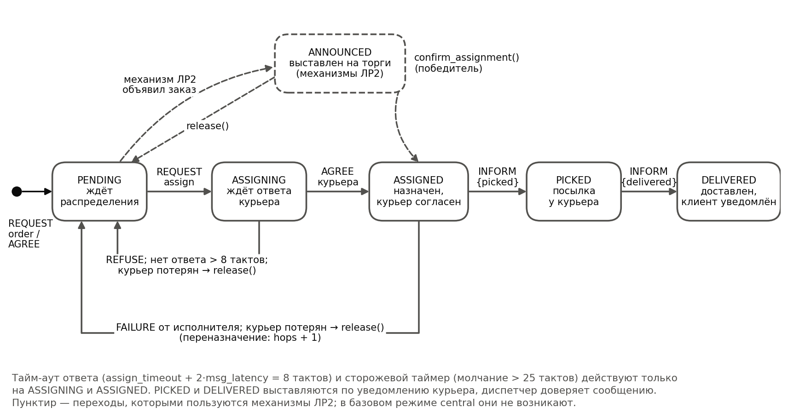

Заказ поступает в книгу в статусе pending (рисунок 6). Механизм central переводит его в assigning, отправляя REQUEST assign, а получив AGREE от того же курьера — в assigned. Из assigning заказ возвращается в pending при отказе, при отсутствии ответа дольше 8 тактов (с отзывом CANCEL) или при потере связи с курьером. Из assigned — при FAILURE исполнителя или потере связи; такой возврат считается переназначением (счётчик передач растёт). Статусы picked и delivered выставляются по уведомлениям курьера; после delivered диспетчер уведомляет клиента. Статус announced используется механизмами ЛР2: заказ выставлен на торги, сторожевой таймер ядра его не трогает, а механизм сам подтверждает победителя или возвращает заказ в pending.

## 6.3. Сценарий «заказ → назначение → забор → доставка → уведомление»

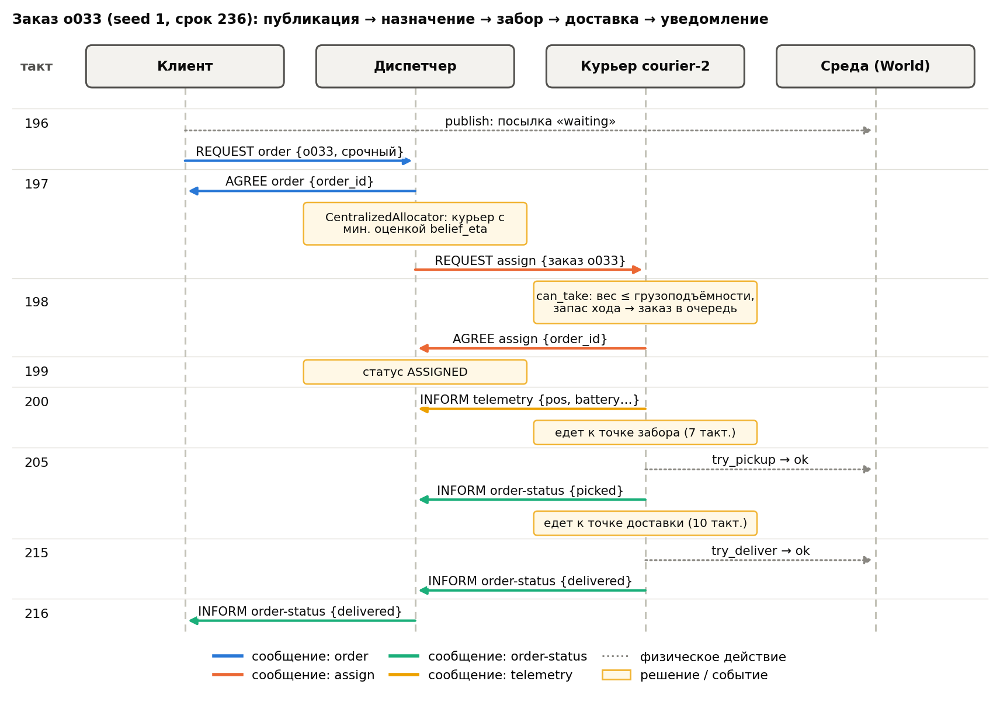

Рисунок 7 построен по трассе прогона seed 1 для срочного заказа o033 весом 6,5 кг (срок — такт 236). Заказ появился на такте 196: клиент поместил посылку в среду и отправил REQUEST order. На такте 197 диспетчер подтвердил приём, выбрал курьера по оценке belief_eta (тяжёлый courier-2, так как груз больше 5 кг) и отправил REQUEST assign. На такте 198 курьер проверил выполнимость, поставил заказ в очередь и ответил AGREE. На такте 199 диспетчер зафиксировал назначение — задержка назначения составила ровно 3 такта. Курьер ехал к точке забора 7 тактов, на такте 205 забрал посылку и сообщил INFORM {picked}, ещё 10 тактов вёз её и доставил на такте 215 — за 21 такт до срока. Уведомление клиенту ушло на такте 216 и было получено на такте 217. Пунктиром на рисунке показаны физические действия над средой: они не являются сообщениями и не проходят через шину.

## 6.4. Сценарий «зарядка с очередью»

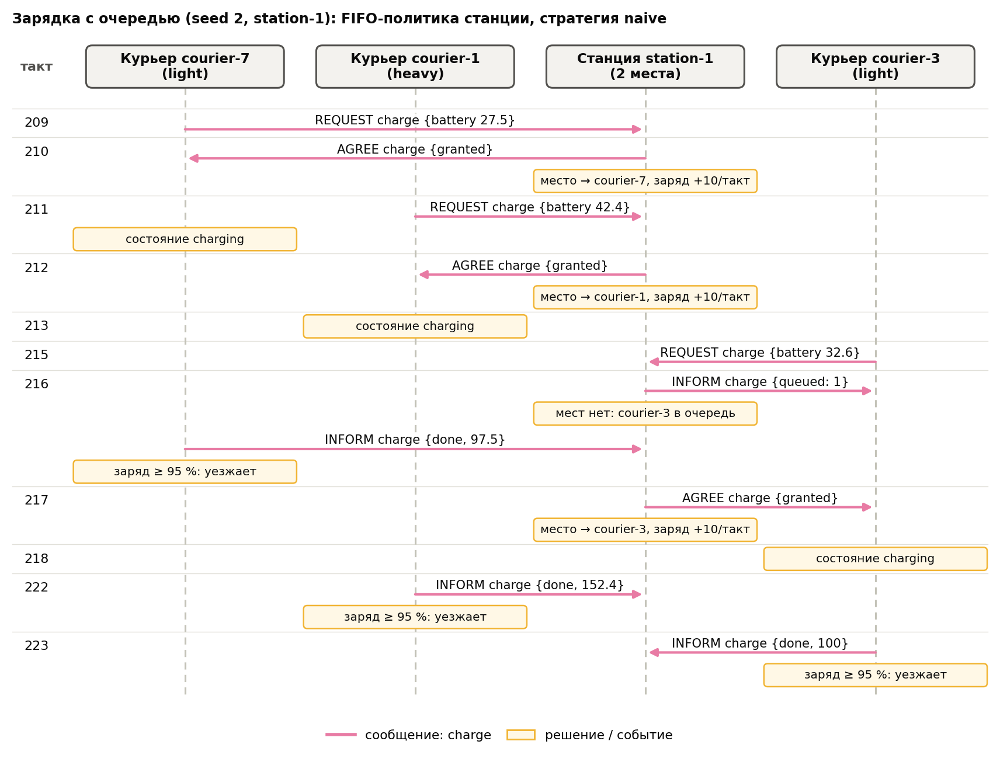

Рисунок 8 — первый по номеру seed эпизод очереди на станции в базовых прогонах (seed 2, station-1, 2 места). На тактах 209–212 места заняли courier-7 и тяжёлый courier-1. На такте 215 прибыл courier-3 и запросил место; на такте 216 станция ответила INFORM {queued: 1}. В том же такте courier-7 закончил зарядку и сообщил об этом; на такте 217 станция освободила место и выдала его первому в очереди (AGREE), и с такта 218 courier-3 заряжался. Ожидание courier-3 по показателю «ожидание зарядки» — 3 такта. Минимальное значение этого показателя — 2 такта: это время пересылки REQUEST и AGREE (2L), поэтому реальная очередь видна только как превышение двух тактов. Станция начинает заряжать курьера в такт выдачи места, ещё до того, как AGREE дойдёт до курьера; поэтому в момент перехода в charging заряд курьера уже на 20 единиц выше, чем в запросе.

## 6.5. Сценарий «телеметрия и сторожевой таймер»

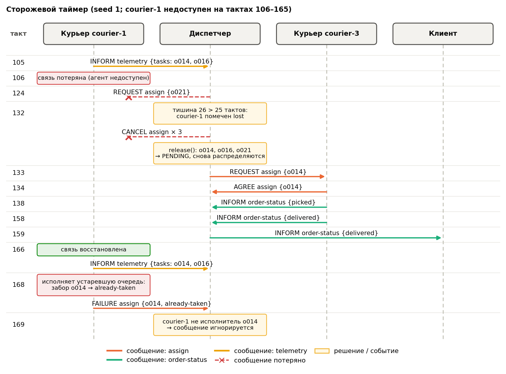

В 30 базовых прогонах нет ни одной потери связи, переназначения или разрядки в пути. Поэтому для проверки сторожевого таймера выполнен проверочный прогон seed 1, в котором через стандартную точку расширения (обработчик начала такта) courier-1 на 60 тактов становится недоступен: не действует и не принимает сообщения. Момент выбран автоматически — первый такт после 30-го, когда у курьера есть незабранный текущий заказ и очередь.

Последнее сообщение courier-1 (телеметрия со списком заказов o014, o016) отправлено на такте 105 и получено на такте 106. REQUEST assign o021 на такте 124 и три CANCEL на такте 132 потеряны, потому что получатель недоступен (всего 4 потерянных сообщения). На такте 132 тишина составила 26 > 25 тактов, диспетчер пометил курьера потерянным и вернул в распределение o014, o016 и o021; уже на тактах 133–135 они назначены другим курьерам (o014 — courier-3, доставлен на такте 158). Все 60 заказов доставлены, но доля доставок в срок снизилась с 95 % до 83,3 %, время выполнения всех заказов выросло с 384 до 390 тактов, переназначений — 2 (o021 был ещё в статусе assigning и переназначением не считается).

Проверка выявила ограничение базовых протоколов. После восстановления связи на такте 166 courier-1 продолжил выполнять устаревшую очередь, потому что CANCEL до него не дошли. Его телеметрия снова содержала o014 и o016, но диспетчер не сверяет список заказов из телеметрии со своей книгой. В итоге courier-1 безуспешно пытался забрать уже доставленный o014 (такт 168), а o016 забрал раньше нового исполнителя courier-2, и уже тот получил «already-taken» (такт 200). Диспетчер принял уведомление о заборе o016 от courier-1, поскольку не сверяет отправителя с исполнителем. Физическая согласованность сохранилась — посылку не могут забрать дважды, — но появились холостые поездки (2 неудачных забора). Это готовый материал для ЛР4: нужны эпохи назначений, сверка состояния после восстановления связи и проверка исполнителя.

# 7. Обоснование архитектуры

## 7.1. Требования к архитектуре

Из задачи и содержания ЛР2–ЛР4 следуют требования:

1. автономные исполнители с локальным знанием и собственной безопасностью (батарея);
2. явная, проверяемая логика агентов и правил взаимодействия — требование курса;
3. сменные механизмы распределения задач при неизменных среде, агентах и потоке заказов (ЛР2);
4. дефицитный общий ресурс и возможность ввести новые роли (арбитр) и переговоры о нём (ЛР3);
5. все взаимодействия — наблюдаемые сообщения с заявленным и истинным отправителем, полномочиями и трассой; возможность подменить агента, внести сбой канала (ЛР4);
6. воспроизводимость и скорость: серии по 20–30 seed для каждого варианта, одинаковые заказы для всех режимов;
7. демонстрация в разных режимах.

## 7.2. Сравнение альтернатив

Таблица 11 — Сравнение архитектурных альтернатив («+» — хорошо, «±» — частично, «−» — плохо)

| Критерий | Централизованный оптимизатор | Реактивный рой | Делиберативные BDI-агенты | LLM-агенты | Гибрид (выбран) |
|---|:---:|:---:|:---:|:---:|:---:|
| Соответствие распределённой природе задачи | − | + | + | + | + |
| Качество решений при полной информации | + | − | + | ± | ± |
| Реакция на угрозы безопасности (батарея) за такт | ± | + | − | − | + |
| Явность и проверяемость логики | + | ± | ± | − | + |
| Воспроизводимость и скорость серий | + | + | ± | − | + |
| Устойчивость к отказу одного узла | − | + | + | + | ± |
| Пригодность для ЛР2 (механизмы распределения) | − | − | + | ± | + |
| Пригодность для ЛР3 (переговоры, арбитраж) | − | − | + | ± | + |
| Пригодность для ЛР4 (явные сообщения, полномочия) | − | ± | + | ± | + |

Пояснения:

- **Централизованный оптимизатор** (одна программа решает задачу маршрутизации с окнами времени) даёт лучшие решения при полной и свежей информации. Но задача NP-трудна и при каждом новом заказе требует пересчёта, автономных участников нет, переговоры и рыночные механизмы моделировать не на ком, а оптимизатор — единая точка отказа. Как механизм распределения внутри диспетчера такой подход допустим — режим central так и устроен, только с жадной эвристикой.
- **Реактивный рой** (курьеры по локальным правилам, без обязательств) устойчив и дёшев, но не учитывает сроки и не даёт обязательств «кто везёт заказ». Исследовать в нём распределение задач и переговоры о ресурсе нечем.
- **Чисто делиберативные BDI-агенты** выразительны, но цикл «убеждения — желания — намерения» тяжёл для реакций, которые надо выполнить в том же такте (не сделать шаг без заряда). Кроме того, такую логику труднее проверить и объяснить.
- **LLM-агенты** гибко понимают свободный текст, но недетерминированы, дороги, не дают воспроизводимых серий по 30 seed и сами уязвимы к внедрению инструкций. Это противоречит требованиям 2 и 6. При этом модель «наивного обработчика заметок», который исполняет текст из поля note заказа, используется в ЛР4 как объект атаки.
- **Гибрид** сочетает реактивный слой безопасности, делиберативный слой оценок и подключаемый слой координации; устойчивость к отказу курьера обеспечивает сторожевой таймер. Слабое место — диспетчер как единый узел в режиме central (в таблице «±»). Но это свойство одного механизма, а не архитектуры: в режимах ЛР2 (делегирование) роль центра уменьшается.

## 7.3. Выбранная архитектура

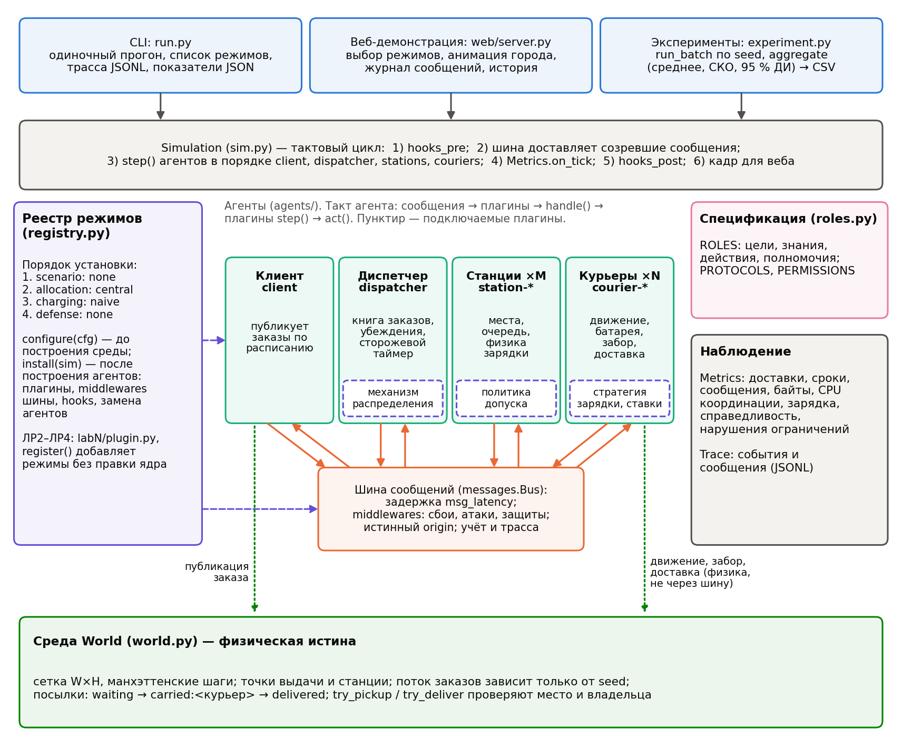

На уровне системы (рисунок 10) выделены:

- **среда** — физическая истина (положения, посылки, физика движения и зарядки); агенты действуют на неё напрямую, но видят её только через свои датчики;
- **агенты четырёх ролей** с одинаковым циклом такта и подключаемыми модулями поведения;
- **шина сообщений** — единственный канал связи, с задержкой, промежуточными обработчиками, истинным отправителем и учётом;
- **реестр режимов** — четыре независимых измерения режима (сценарий, распределение, зарядка, защита); каждый режим подключается функцией установки после построения агентов;
- **спецификация** (роли, протоколы, полномочия) и **наблюдение** (показатели и трасса);
- **интерфейсы**: командная строка, веб-демонстрация, серийные эксперименты.

На уровне агента архитектура гибридная, трёхслойная (таблица 12).

Таблица 12 — Слои архитектуры агентов

| Слой | Курьер | Диспетчер | Станция |
|---|---|---|---|
| Реактивный (каждый такт, приоритетный) | Проверка заряда перед каждым шагом (иначе stranded); проверка потребности в зарядке до движения; немедленные ответы на REQUEST и CANCEL | Сторожевой таймер и тайм-аут ответа на назначение; немедленный AGREE клиенту | Освобождение места ушедшего курьера; физика зарядки |
| Делиберативный | Выполнимость заказа по грузу и запасу хода; оценка добавления заказа (дополнительный путь, время завершения, энергия); остаток маршрута; выбор станции | Убеждения о курьерах и оценка времени завершения; ведение книги заказов | Решение о допуске и очереди |
| Координационный (подключаемый) | Участие в торгах (ЛР2), стратегия зарядки и переговоры (ЛР3), фильтры сообщений (ЛР4) | Механизм распределения (ЛР2), защиты (ЛР4) | Политика допуска, переговоры, арбитраж мощности (ЛР3) |

Порядок действий курьера в такте фиксирует приоритеты слоёв: сначала проверка stranded и решение о зарядке, затем движение к станции или работа над заказом, в конце телеметрия.

## 7.4. Модель времени и отказ от готовых фреймворков

Выбрана дискретная по времени (тактовая) имитация с очередью сообщений: сообщения — события с временем доставки, агенты действуют в каждом такте в фиксированном порядке. Причины:

- **воспроизводимость:** без потоков и недетерминированного планировщика; заказы генерируются только из seed, решения агентов и сбои — из отдельного генератора, зависящего от seed;
- **явная задержка связи** и устаревание убеждений — параметр модели, а не случайность среды выполнения (важно для сравнения в ЛР2);
- **скорость:** 30 прогонов базового режима выполняются менее чем за секунду (0,6–0,7 с вместе с записью CSV на машине автора), поэтому серии по 30 seed для каждого варианта в ЛР2–ЛР4 укладываются в секунды и минуты.

Готовые МАС-фреймворки (JADE, SPADE, Mesa) не использованы. Требование курса — описать и запрограммировать логику и правила взаимодействия в явной форме; фреймворк скрыл бы часть этой логики в своей инфраструктуре. Кроме того, для ЛР4 нужен полный контроль над каналом — истинный отправитель, перехват, искажение и внедрение сообщений, — что проще и прозрачнее в собственной шине. Ядро использует только стандартную библиотеку Python; matplotlib и python-docx нужны лишь для рисунков и отчётов.

## 7.5. Как архитектура обеспечивает ЛР2–ЛР4

Таблица 13 — Поддержка последующих работ

| Работа | Что исследуется | Чем это обеспечено |
|---|---|---|
| ЛР2 | Централизованная диспетчеризация, контрактная сеть, аукцион, делегирование | Категория режима allocation; механизм — плагин диспетчера с доступом к книге заказов (заказы к распределению, назначение, статус announced, подтверждение победителя, возврат); плагины курьеров для ставок на основе их собственной оценки заказа; зарезервированные перформативы CFP, PROPOSE, ACCEPT-PROPOSAL, REJECT-PROPOSAL; учёт сообщений по протоколам, времени работы механизма и задержки назначения; общие случайные числа; режим central — эталон |
| ЛР3 | Переговоры и разрешение конфликтов при дефиците мест и мощности | Дефицит задаётся параметрами: число мест, число курьеров, лимит мощности; стратегия зарядки курьера и политика станции — плагины; новая роль-арбитр добавляется как агент и описывается в ROLES и таблице полномочий; показатели ожидания зарядки и его справедливости, тактов превышения мощности, нарушений, разрядок; параметры для эгоистичных агентов; базовый режим naive + FIFO — состояние «до» |
| ЛР4 | Неблагоприятные сценарии и защиты | Все взаимодействия — явные сообщения через одну шину; промежуточные обработчики шины (потеря, искажение, внедрение, повтор); истинный отправитель против заявленного; отключение агентов и станций обработчиками такта; замена агента злонамеренной версией; свободный текст заказа; таблица полномочий для авторизации; трасса JSONL; категории scenario и defense. Проверочный прогон (раздел 6.5) уже показал уязвимости: доверие к заявленному отправителю и отсутствие сверки состояния после восстановления связи |

# 8. Программная реализация

Ядро — пакет `lab1/mas` (таблица 14).

Таблица 14 — Модули ядра

| Модуль | Назначение |
|---|---|
| config.py | Параметры моделирования и типы курьеров |
| world.py | Среда: сетка, точки выдачи, станции, заказы, физическое состояние посылок, генератор потока заказов |
| messages.py | Перформативы, сообщение, шина (задержка, промежуточные обработчики, учёт) |
| agents/base.py | Базовый агент и подключаемый модуль поведения; цикл такта агента |
| agents/client.py, dispatcher.py, courier.py, station.py | Четыре роли |
| allocation.py | Базовый механизм распределения central и оценка belief_eta |
| charging.py | Базовая стратегия зарядки naive и политика станции FIFO |
| roles.py | Спецификация ролей, протоколов и таблица полномочий |
| registry.py | Реестр режимов, загрузка модулей labN/plugin.py |
| sim.py | Имитация: построение агентов, цикл такта, кадры для веба |
| metrics.py, trace.py | Показатели и трасса |
| experiment.py | Серийные прогоны, агрегирование (среднее, СКО, 95 % ДИ), CSV |

Точки расширения: механизм распределения (плагин диспетчера), участие курьеров в торгах (плагин курьера), стратегия зарядки курьера и политика станции, новые агенты, промежуточные обработчики шины и обработчики такта, замена агента, фильтры входящих сообщений, пользовательские показатели и таймеры, свободные параметры механизмов. Каждая следующая работа оформляется пакетом `labN` с функцией регистрации режимов; ядро, командная строка и веб-демонстрация подхватывают их автоматически, а ошибка загрузки одного пакета не роняет систему.

Режимы демонстрации:

- **командная строка** (`lab1/run.py`): список зарегистрированных режимов, одиночный прогон с выбором режимов и параметров (seed, число курьеров, заказов, станций, мест, интенсивность потока), таблица показателей, трасса JSONL, все показатели в JSON;
- **веб-демонстрация** (`lab1/web/server.py`): выбор режима по четырём категориям, включая режимы ЛР2–ЛР4, и параметров; анимация города по тактам; таблица курьеров и станций в текущий такт; журнал событий и сообщений с фильтром; история прогонов для сравнения режимов;
- **серийные эксперименты** (`experiment.run_batch`): прогоны по набору seed для нескольких вариантов, агрегирование, сохранение CSV.

Рисунки и базовая таблица этой работы строятся скриптом `lab1/docs/make_figures.py`. Скрипт намеренно не загружает модули ЛР2–ЛР4, поэтому диаграммы отражают только ядро.

# 9. Пример работы базового режима

## 9.1. Конфигурация

Базовый режим: распределение `central`, зарядка `naive` (станция FIFO), сценарий `none`, защита `none`. Параметры — значения по умолчанию (таблица 15). Прогоны выполнены для seed 1–30; при одинаковом seed поток заказов один и тот же во всех режимах.

Таблица 15 — Параметры базового режима

| Параметр | Значение |
|---|---|
| Сетка | 20 × 20 |
| Точки выдачи / станции / мест на станции | 4 / 2 / 2 |
| Скорость зарядки | 10 ед. за такт |
| Лимит мощности сети | не задан |
| Курьеры | 8 (2 тяжёлых, 6 лёгких) |
| Резерв заряда / задержка эвакуации | 10 % ёмкости / 40 тактов |
| Заказы | 60, поток 0,2 заказа за такт; 20 % тяжёлых, 20 % срочных |
| Задержка сообщений | 1 такт |
| Период телеметрии / сторожевой таймер / ожидание ответа на назначение | 5 / 25 / 6 (+2 на пересылку) тактов |
| Предел длительности прогона | 2000 тактов |

## 9.2. Показатели

Таблица 16 — Показатели базового режима (30 прогонов; среднее ± полуширина 95 % доверительного интервала по нормальному приближению)

| Показатель | Среднее ± 95 % ДИ | Мин – макс |
|---|---:|---:|
| Доля доставленных | 1,000 ± 0 | 1,000 – 1,000 |
| Доля доставленных в срок | 0,962 ± 0,013 | 0,850 – 1,000 |
| Доля срочных, доставленных в срок | 0,856 ± 0,038 | 0,643 – 1,000 |
| Опозданий, заказов из 60 | 2,3 ± 0,8 | 0 – 9 |
| Среднее время доставки, тактов | 30,9 ± 1,7 | 23,6 – 41,5 |
| 95-й перцентиль времени доставки, тактов | 65,8 ± 5,8 | 42,4 – 104,1 |
| Задержка назначения, тактов | 3,0 ± 0 | 3 – 3 |
| Время выполнения всех заказов, тактов | 353,4 ± 12,0 | 297 – 426 |
| Суммарный пробег, клеток | 1450 ± 35 | 1276 – 1625 |
| Израсходовано энергии, усл. ед. | 1923 ± 42 | 1680 – 2107 |
| Выручка (сумма вознаграждений) | 1184 ± 14 | 1078 – 1253 |
| Сообщений за прогон | 1048 ± 19 | 968 – 1161 |
| Сообщений на заказ | 17,5 ± 0,3 | 16,1 – 19,4 |
| Сеансов зарядки | 19,5 ± 0,6 | 17 – 23 |
| Среднее ожидание места, тактов | 2,11 ± 0,07 | 2,00 – 2,82 |
| Максимальное ожидание места, тактов | 3,5 ± 0,8 | 2 – 9 |
| Пиковое число одновременно заряжающихся | 2,83 ± 0,17 | 2 – 4 |
| Разрядок в пути / переназначений / неудачных заборов | 0 / 0 / 0 | — |
| Индекс Джайна по числу заказов | 0,935 ± 0,011 | 0,843 – 0,987 |
| Индекс Джайна по доходу | 0,902 ± 0,015 | 0,814 – 0,979 |
| Загрузка курьеров (доля тактов не в idle) | 0,551 ± 0,024 | 0,432 – 0,735 |

Процессорное время механизма распределения — около 2 мс на прогон (порядка 0,03 мс на заказ). Значение зависит от ЭВМ и в разных запусках скрипта менялось от 1,7 до 2,2 мс в среднем по 30 прогонам, поэтому в таблицу не вынесено; значения последнего запуска — в `baseline.csv`.

## 9.3. Наблюдения

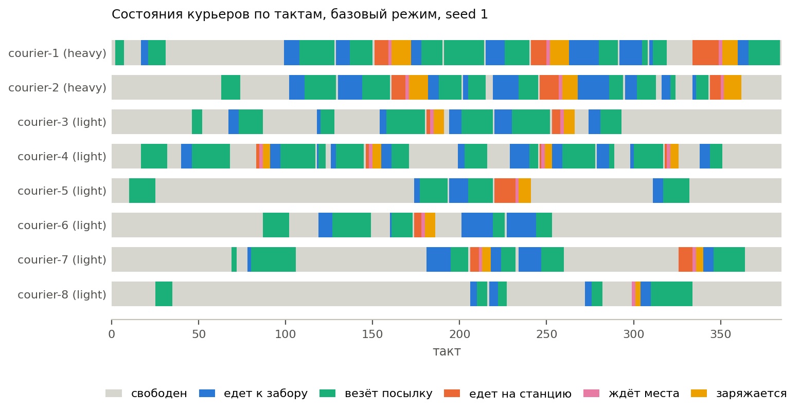

1. **Система работает штатно.** Во всех 30 прогонах доставлены все 60 заказов, нет разрядок в пути, переназначений, неудачных заборов и потерянных сообщений. Опоздания были в 26 прогонах из 30 — в среднем 2,3 заказа из 60.
2. **Слабое место — срочные заказы.** В срок доставлено 96,2 % всех заказов, но только 85,6 % срочных (в худшем прогоне 64,3 %). Механизм central первыми распределяет срочные заказы, но ставит их в конец очереди выбранного курьера и не перестраивает уже принятые очереди.
3. **Назначение мгновенное.** Задержка назначения во всех заказах равна 3 тактам, то есть 3L. В базовом режиме нет ни одного отказа: диспетчер сам отсеивает курьеров по грузоподъёмности, а запас хода на сетке 20×20 всегда достаточен. Механизм всегда находит исполнителя, ставя заказ в очередь даже занятому курьеру.
4. **Неравномерная загрузка флота.** Тяжёлые курьеры доставляют в среднем 9,6–10,0 заказа за прогон, лёгкие — от 5,8 до 7,7, а энергии тяжёлые тратят около 400 единиц против 160–205 у лёгких. Из 588 заказов, которые за 30 прогонов доставили тяжёлые курьеры, 192 (33 %) были лёгкими, хотя их могли бы везти экономичные лёгкие курьеры. Причины — оценка только по времени, без стоимости энергии, и выбор курьера с меньшим номером при равных оценках (курьеры 1–4 стартуют в тех же точках, что и 5–8). На рисунке 11 видно, как курьеры 5–8 подолгу стоят свободными. Индексы Джайна 0,935 по заказам и 0,902 по доходу — точка отсчёта для механизмов ЛР2 и для справедливости в ЛР3.
5. **Трафик — в основном мониторинг.** На заказ приходится 17,5 сообщения, из них 9,5 — телеметрия (54,4 % всего трафика); собственно распределение стоит 4 сообщения на заказ (таблица 10).
6. **Зарядная инфраструктура в базовом режиме не дефицитна.** Около 19,5 сеансов зарядки за прогон, среднее ожидание 2,1 такта при минимально возможных 2. Постановки в очередь были в 13 прогонах из 30 (в одном из них место освободилось в тот же такт), ожидание дольше минимальных 2 тактов — в 12, максимум — 9 тактов. Одновременно заряжались до 4 курьеров, то есть были заняты все места сети. Для ЛР3 дефицит нужно создать: увеличить флот и поток заказов, сократить число мест, задать лимит мощности.
7. **У флота есть запас.** Средняя загрузка курьеров — 55 %, поэтому поток 0,2 заказа за такт для 8 курьеров — умеренная нагрузка. В ЛР2 нагрузку нужно варьировать.

## 9.4. Особенности реализации, выявленные при проверке

Эти свойства не нарушают работу базового режима, но их нужно учитывать при интерпретации показателей и в следующих работах:

- после восстановления связи курьер продолжает выполнять устаревшую очередь, а диспетчер не сверяет список заказов из телеметрии со своей книгой и принимает уведомления о заборе и доставке от любого отправителя (раздел 6.5);
- станция начинает зарядку в такт выдачи места, до получения курьером AGREE, а показатель «ожидание зарядки» включает время пересылки запроса и ответа (минимум 2 такта);
- прогон заканчивается в такт физической доставки последней посылки, поэтому последнее уведомление клиенту не отправляется (в среднем 179 сообщений order-status вместо 180), а число сообщений меньше оценки по протоколам на 1–3;
- убеждения диспетчера о «хвосте» маршрута не учитывают оставшееся время зарядки курьера: телеметрия сообщает время освобождения только по длине маршрута. Это одна из причин, по которым механизмы с собственными оценками курьеров (ЛР2) могут работать лучше централизованного.

# 10. Выводы

1. Выбрана прикладная задача — городская доставка автономными курьерами двух типов с общей ограниченной зарядной инфраструктурой. Задача распределённая, исполнители автономны и отвечают за собственную безопасность, в ней есть дефицитный ресурс и естественные конфликты интересов, поэтому многоагентный подход для неё обоснован.
2. Построена формальная модель: среда, ограничения и критерии; МАС как кортеж ⟨Env, Ag, R, Π, M, Org⟩; схемы четырёх ролей (цели, знания, состояния, действия, полномочия, средства, обязанности живучести и безопасности); модель сообщений на основе FIPA-ACL с задержкой и истинным отправителем; пять протоколов с пред- и постусловиями, тайм-аутами и правилами отказа и отзыва; таблица полномочий; организационная структура. Спецификация записана в коде в машиночитаемой форме, и диаграммы строятся из неё автоматически.
3. Построены диаграмма ролей, проектный и наблюдаемый графы коммуникаций, диаграммы состояний курьера и жизненного цикла заказа, три диаграммы последовательности по реальным трассам и схема архитектуры.
4. Обоснована гибридная архитектура: реактивный слой безопасности по батарее, делиберативный слой оценок и подключаемый слой координации; тактовая имитация с общими случайными числами; собственная шина сообщений вместо фреймворка. Архитектура напрямую поддерживает ЛР2 (сменные механизмы распределения), ЛР3 (дефицит мест и мощности, новые роли, переговоры) и ЛР4 (явные сообщения, полномочия, истинный отправитель, трасса, подмена агентов).
5. Базовый режим на 30 seed работает штатно: все заказы доставлены, 96,2 % в срок (срочные — 85,6 %), 17,5 сообщения на заказ, больше половины трафика — телеметрия. Найдены точки улучшения для следующих работ: срочные заказы, неравномерная и энергетически неэффективная загрузка флота (тяжёлые курьеры везут лёгкие заказы), отсутствие сверки состояния после потери связи и доверие к заявленному отправителю.

# Приложение А. Исходный код и демонстрационные материалы

Исходный код, скрипт построения рисунков, таблица результатов и рисунки размещены в репозитории: https://github.com/denvyworking/mo-labs.

- Ядро МАС: `lab1/mas/`; описание ядра и точек расширения: `lab1/README.md`.
- Командная строка: `lab1/run.py`; веб-демонстрация: `lab1/web/`.
- Рисунки и базовая таблица: `lab1/docs/make_figures.py`, `lab1/figures/`, `lab1/results/baseline.csv`.

# Приложение Б. Запуск

Все команды выполняются из корня репозитория (Python 3.11+; для рисунков нужен matplotlib, для отчёта — python-docx).

- Список режимов: `python lab1/run.py --list`
- Одиночный прогон: `python lab1/run.py --seed 3 --couriers 8`
- Прогон с трассой и всеми показателями: `python lab1/run.py --trace trace.jsonl --json`
- Веб-демонстрация: `python lab1/web/server.py --port 8000`, затем открыть http://localhost:8000
- Рисунки и базовая таблица: `python lab1/docs/make_figures.py`
- Отчёт в DOCX: `python lab1/tools/md2docx.py lab1/report.md lab1/report.docx`
