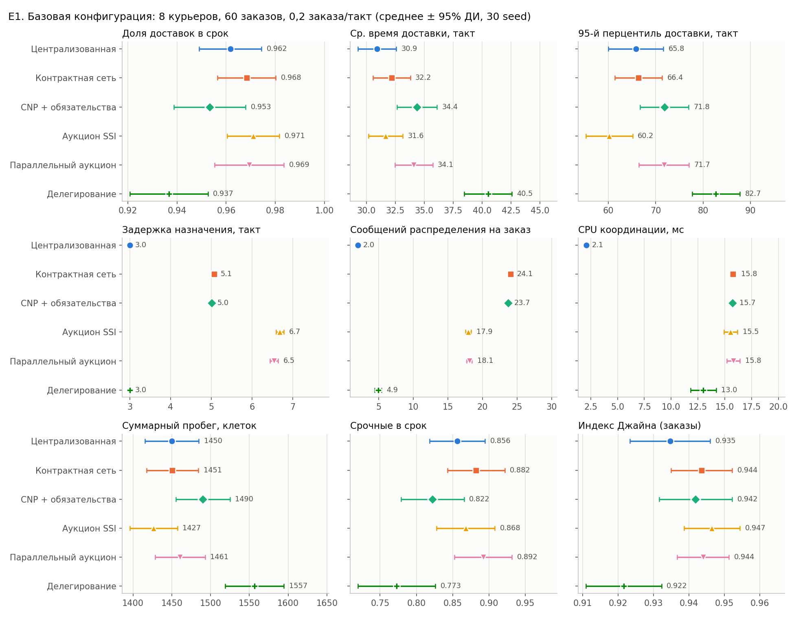
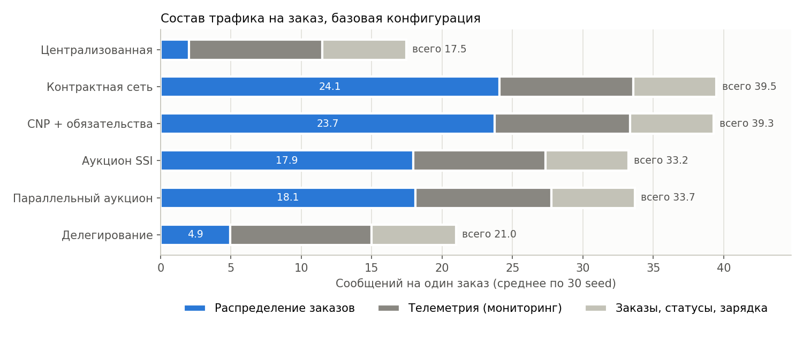
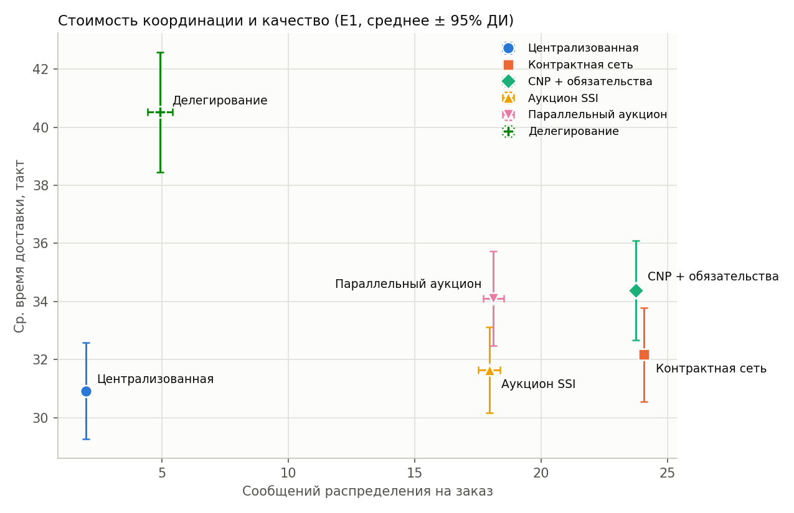
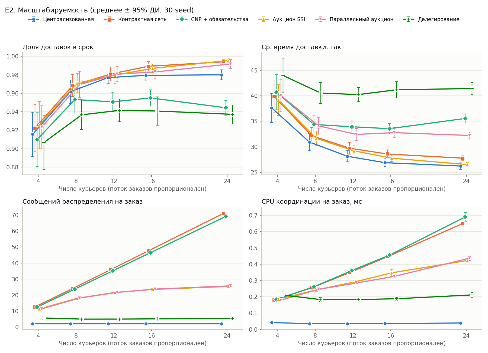
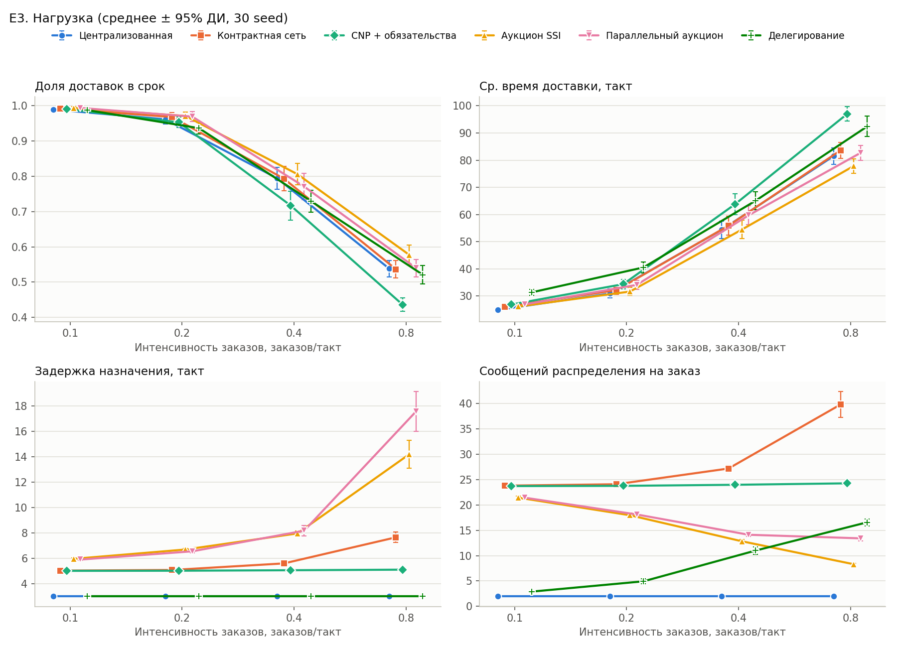
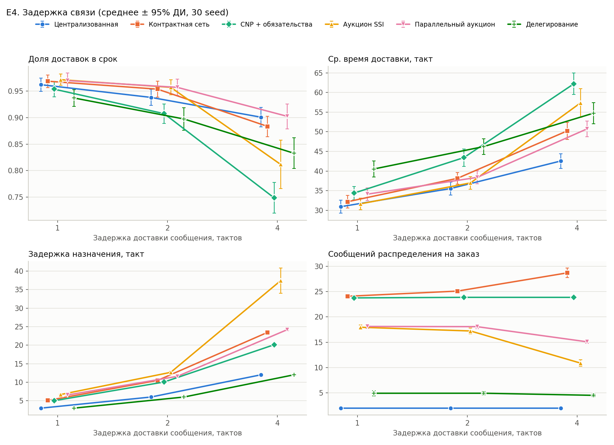
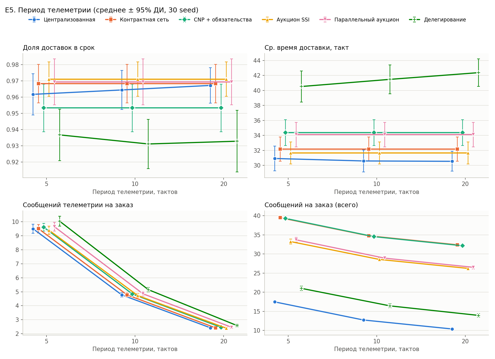

# 1. Цель и постановка задачи

Цель работы — реализовать на ядре многоагентной системы «Городская доставка автономными курьерами» (ЛР1) несколько механизмов распределения заказов между курьерами и экспериментально сравнить их по качеству работы системы и по стоимости координации.

Система моделирует город-сетку 20×20 с дискретным временем. Клиент публикует заказы пуассоновским потоком в четырёх точках выдачи. У заказа есть вес, срок и приоритет (обычный или срочный). Восемь курьеров двух типов (2 тяжёлых до 20 кг, 6 лёгких до 5 кг) тратят заряд на движение и заряжаются на двух станциях. Диспетчер ведёт книгу заказов и получает от курьеров телеметрию. Агенты взаимодействуют только сообщениями через шину, доставка сообщения занимает `msg_latency` тактов.

Задача распределения: каждый поступивший заказ передать курьеру так, чтобы как можно больше заказов было доставлено в срок, среднее время доставки было мало, а координация (сообщения, вычисления, ожидание решения) обходилась дёшево. Сравниваются шесть режимов категории `allocation`:

- `central` — централизованная диспетчеризация (базовый режим ядра);
- `cnp` — контрактная сеть;
- `cnp-commit` — контрактная сеть с предварительными обязательствами в ставках;
- `auction` — последовательный аукцион по одному лоту (SSI) с платой по второй цене;
- `auction-par` — параллельный одноразовый аукцион;
- `delegation` — распределённое делегирование между курьерами.

Ядро ЛР1 не изменялось. Каждый механизм подключается как плагин диспетчера и плагин курьера. Новые протоколы `cnp`, `auction` и `delegate` внесены в таблицу полномочий ролей.

# 2. Описание механизмов

## 2.1. Общие элементы

**Жизненный цикл заказа в книге диспетчера.** Заказ в статусе PENDING ждёт распределения. В статусе ANNOUNCED он выставлен на торги, и сторожевой таймер ядра его не трогает. В статусе ASSIGNING исполнитель выбран, но ещё не подтвердил. Затем следуют ASSIGNED, PICKED и DELIVERED. Если подтверждение не пришло за `assign_timeout + 2·latency` тактов, сторожевой таймер ядра отзывает назначение (CANCEL) и возвращает заказ в PENDING. Курьер, который не может выполнить принятый заказ (забор не удался, разрядка в пути), сообщает FAILURE по протоколу ядра `assign`, и заказ тоже возвращается в очередь. Все механизмы пользуются этими общими правилами, поэтому ни один заказ не теряется: во всех 2880 прогонах доставлено 100 % заказов.

**Ставка курьера.** Во всех рыночных механизмах ставка — ожидаемый такт завершения заказа, если поставить его в конец очереди курьера. Курьер считает её сам по своему точному состоянию: положению, оставшемуся маршруту, заряду, возможному заезду на зарядку и оставшемуся времени зарядки, если он заряжается. Чем меньше ставка, тем лучше. Для критерия «сумма времён завершения заказов» такая ставка равна маргинальной стоимости: добавление заказа в конец маршрута не сдвигает остальные заказы, а сумма растёт ровно на время завершения нового.

**Оценка диспетчера в режиме `central`.** Диспетчер оценивает тот же такт завершения по своим убеждениям: последней телеметрии (конец маршрута, время его достижения, заряд в конце маршрута) и уже сделанным им назначениям. Время, которое курьер ещё простоит на зарядке, в телеметрию не входит. Поэтому оценки диспетчера в среднем менее точны, чем оценки самих курьеров.

**Учёт затрат.** Сообщения считает шина: по протоколам и перформативам, с объёмом в байтах. Вычисления механизма замеряются отдельно на стороне диспетчера и на стороне курьеров, их сумма даёт CPU координации.

## 2.2. Централизованная диспетчеризация (`central`)

Каждый такт диспетчер перебирает ожидающие заказы в порядке срочности (сначала срочные, затем по сроку). Для каждого заказа он выбирает курьера с подходящей грузоподъёмностью и минимальным ожидаемым тактом завершения по своим убеждениям. Затем отправляет ему REQUEST по протоколу `assign` и сразу дописывает этот заказ в свои убеждения о курьере. Курьер проверяет, сможет ли взять заказ (вес, запас хода от станции до станции), и отвечает AGREE или REFUSE. После отказа заказ возвращается в очередь, а отказавший курьер исключается для этого заказа на 10 тактов. На заказ уходит 2 сообщения, время назначения — 3·latency.

## 2.3. Контрактная сеть (`cnp`, `cnp-commit`)

Диспетчер выступает менеджером, курьеры — участниками. По каждому заказу проводятся отдельные торги (таблица 1).

Таблица 1 — Протокол контрактной сети

| Шаг | Отправитель → получатель | Перформатив | Содержание | Статус заказа |
|---|---|---|---|---|
| 1 | менеджер → все курьеры на связи | CFP | номер торгов, заказ, срок приёма предложений | ANNOUNCED |
| 2 | курьер → менеджер | PROPOSE или REFUSE | ставка (ожидаемый такт завершения) или причина отказа | ANNOUNCED |
| 3 | менеджер → лучший участник | ACCEPT-PROPOSAL | номер заказа, ставка | ASSIGNING |
| 4 | менеджер → остальные предложившие | REJECT-PROPOSAL | номер заказа | — |
| 5 | победитель → менеджер | INFORM (обязательство принято) или FAILURE | номер заказа, причина | ASSIGNED или PENDING |

**Правила менеджера.** Торги закрываются, когда ответили все приглашённые или наступил срок `t + 2·latency + 1`. Побеждает наименьшая ставка. Если предложений нет, заказ возвращается в очередь и объявляется снова через 10 тактов. Предложение, пришедшее после закрытия торгов, менеджер отклоняет (REJECT), чтобы участник снял с себя обязательство. FAILURE от победителя возвращает заказ в очередь, и он сразу объявляется заново.

**Правила участника.** Курьер отказывается (REFUSE), если заказ ему не по силам по весу или запасу хода. Иначе он отвечает ставкой. Получив ACCEPT, курьер перепроверяет выполнимость с учётом всего, что выиграл после подачи ставки. Если заказ теперь будет выполнен и позже его ставки (с поправкой на прошедшие такты), и позже срока, курьер отвечает FAILURE. Иначе он ставит заказ в очередь и подтверждает обязательство (INFORM).

**Проблема одновременных объявлений.** Торги по разным заказам идут параллельно. Курьер может выиграть несколько контрактов, каждую ставку по которым считал так, будто других заказов нет. Тогда реальное время выполнения окажется хуже обещанного. Проверены два средства:

1. перепроверка победителя (есть в обоих режимах): обнаружить перебор обязательств после факта и вернуть заказ на повторные торги;
2. предварительные обязательства (режим `cnp-commit`): предупредить перебор заранее. Каждое поданное и ещё не решённое предложение курьер учитывает в следующих ставках, как если бы этот заказ уже стоял в его очереди. Обязательство снимается по ACCEPT, по REJECT или по истечении срока.

**Отказы и тайм-ауты.** Если курьер не ответил на CFP, менеджер закрывает торги по сроку с теми предложениями, что пришли. Если победитель молчит после ACCEPT, сторожевой таймер ядра отзывает назначение. Если сообщение менеджера потерялось и обязательство участника «зависло», оно истекает через `срок торгов + 2·latency + 2` такта.

## 2.4. Аукционы по пакету заказов (`auction`, `auction-par`)

Диспетчер выступает аукционистом. Раз в 5 тактов, если предыдущий аукцион завершён, он выставляет пакет из не более чем 6 ожидающих заказов в порядке срочности. Каждый заказ пакета становится лотом.

Таблица 2 — Протокол последовательного аукциона SSI

| Шаг | Отправитель → получатель | Перформатив | Содержание |
|---|---|---|---|
| 1 | аукционист → все курьеры на связи | CFP | номер аукциона, список лотов, срок ответа |
| 2 | курьер → аукционист | PROPOSE или REFUSE | ставки на все посильные лоты |
| 3 | аукционист → победитель раунда | ACCEPT-PROPOSAL | лот, ставка, цена, оставшиеся лоты, нужна ли переоценка |
| 4 | победитель → аукционист | INFORM или FAILURE | подтверждение обязательства по лоту |
| 5 | победитель → аукционист | PROPOSE | новые ставки на оставшиеся лоты (если нужна переоценка) |
| 6 | аукционист → участники с нерешёнными предложениями | REJECT-PROPOSAL | аукцион закрыт |

**Последовательный аукцион по одному лоту (SSI).** В каждом раунде аукционист выбирает среди всех действующих ставок пару «лот — курьер» с наименьшей ставкой и отдаёт лот этому курьеру. Победитель ставит лот в свою очередь, поэтому его следующие ставки учитывают уже выигранные лоты (маргинальная стоимость). Ставки остальных курьеров не меняются, поэтому новые ставки подаёт только победитель. Если на оставшиеся лоты он не ставил (например, они ему не по весу), переоценка не нужна.

**Ускорение раундов без изменения исхода.** После выигрыша лота ставки победителя на другие лоты могут только вырасти: заказ добавлен в конец маршрута, и по неравенству треугольника путь до любого другого лота не короче. Значит, прежние ставки победителя — нижние оценки его новых ставок. Если лучшая ставка остальных участников не больше этих оценок, исход раунда уже известен, и аукционист отдаёт лот, не дожидаясь переоценки. Ждать новых ставок приходится только тогда, когда победитель потенциально может перебить остальных. В предварительной версии без этого правила каждый раунд стоил 2·latency тактов ожидания, и при задержке 4 такта аукцион не успевал за потоком заказов: доля доставок в срок на тех же 30 seed была 0,32, после введения правила — 0,81.

**Цена по второй цене (Викри).** Победитель получает плату, равную наименьшей известной ставке остальных участников на этот лот, отсчитанной от начала аукциона. Если других ставок нет, плата равна его собственной ставке. Плата копится как доход курьера в механизме; показатель `jain_auction_income` — справедливость его распределения. В обратном аукционе с платой по второй цене курьеру невыгодно завышать или занижать ставку относительно своей истинной оценки. Такая честность нужна, когда курьеры принадлежат разным владельцам.

**Параллельный одноразовый аукцион (`auction-par`).** Только один раунд: каждый лот независимо уходит наименьшей ставке, цена тоже вторая. Ставки на разные лоты курьер считает независимо. Поэтому, как и в контрактной сети, курьер может выиграть несколько лотов «в одиночку» и при приёме отказаться от части из них (FAILURE). Такие лоты возвращаются в очередь.

**Отказы и тайм-ауты.** Участник, не ответивший к сроку, дальше участвует без ставок. Лоты без ставок возвращаются в очередь с повтором через 10 тактов. Молчащего победителя обрабатывает сторожевой таймер ядра, как и в остальных механизмах.

## 2.5. Распределённое делегирование (`delegation`)

Диспетчер здесь только маршрутизатор. Каждый заказ он сразу отдаёт курьеру, ближайшему к точке выдачи по последней известной позиции и с подходящей грузоподъёмностью, не глядя на очереди и заряд (REQUEST/AGREE протокола ядра). Дальше решают сами курьеры (таблица 3).

Таблица 3 — Протокол делегирования

| Шаг | Отправитель → получатель | Перформатив | Содержание |
|---|---|---|---|
| 1 | перегруженный курьер A → сосед B | REQUEST | заказ, прогноз A для этого заказа, сколько раз заказ уже передавали |
| 2 | B → A | AGREE (B ставит заказ в очередь) или REFUSE | прогноз B или причина отказа |
| 3 | A → диспетчер | INFORM | заказ передан курьеру B (диспетчер обновляет книгу) |
| 4 | A → B (редко) | CANCEL | согласие пришло после тайм-аута, а заказа у A уже нет |

**Правила курьера A.** Курьер считает себя перегруженным, если по его прогнозу какой-то заказ очереди опоздает или он держит больше двух заказов. Передать он пытается первый опаздывающий заказ, а если опаздывающих нет — последний в очереди. Передаются только не начатые заказы. На время переговоров заказ откладывается, чтобы курьер не поехал за ним. Соседей A опрашивает по одному в случайном порядке, не более трёх за попытку, исключая того, от кого заказ получен. Тайм-аут ответа — 2·latency + 1. Если все отказали, заказ возвращается на прежнее место в очереди и 15 тактов не предлагается. Один заказ передаётся не более двух раз, это защищает от «пинг-понга».

**Правила курьера B.** B соглашается, если заказ ему по силам, после принятия у него будет не больше двух заказов и он выполнит заказ хотя бы на 2 такта раньше, чем A.

## 2.6. Теоретическая оценка числа сообщений на заказ

Обозначения: N — число курьеров; P — число курьеров, сделавших предложение; k — среднее число лотов в аукционе; r — число переоценок на аукцион; U — число отказов при закрытии аукциона; R и D — число запросов на передачу и успешных передач на один заказ. Учитываются только сообщения протокола распределения, без телеметрии и уведомлений о заборе и доставке.

Таблица 4 — Число сообщений распределения на заказ: оценка и измерение (E1, N = 8)

| Механизм | Формула | Оценка для базовой конфигурации | Измерено |
|---|---|---|---|
| Централизованная | 2 (+2 на каждый отказ) | 2 | 2,0 |
| Контрактная сеть | N + N + 1 + (P − 1) + 1 = 2N + P + 1 | P = 6,65 (тяжёлые заказы предлагают только 2 тяжёлых курьера) → 23,7; с повторными торгами после FAILURE ≈ 24,0 | 24,1 |
| Аукцион SSI | (2N + U)/k + 2 + r/k | k = 1,40, r = 0,32, U = 5,9 → 17,9 | 17,9 |
| Параллельный аукцион | (2N + U)/k + 2 | k = 1,41, U = 6,1 → 17,7; плюс повторные аукционы после FAILURE | 18,1 |
| Делегирование | 2 + 2R + D | R = 1,32, D = 0,30 → 4,9 | 4,9 |

Значения P, k, r, U, R и D в таблице взяты из тех же прогонов, по ним проверяется сама формула.

Время до назначения без учёта ожидания в очереди: у централизованной схемы 3·latency (заказ, запрос, согласие), у контрактной сети 5·latency (заказ, CFP, предложение, ACCEPT, подтверждение). У аукциона к этому добавляется ожидание начала аукциона (до 5 тактов) и по 2·latency на каждую переоценку, которой нельзя избежать.

Число сообщений контрактной сети на заказ растёт линейно с числом курьеров. У аукциона рассылка CFP делится на k лотов пакета, поэтому чем больше заказов успевает накопиться (при большом потоке или большом флоте), тем дешевле аукцион в пересчёте на заказ. У централизованной схемы и делегирования затраты от N не зависят.

# 3. Методика экспериментов

Эксперименты запускаются скриптом `lab2/experiments.py`. Каждая конфигурация прогоняется для 30 значений seed (1–30). При одинаковом seed поток заказов (время появления, точки, веса, сроки) одинаков для всех механизмов — это метод общих случайных чисел. Поэтому различия между механизмами можно оценивать и по парным разностям на одних и тех же seed. Прогоны выполнялись последовательно в одном процессе, чтобы замеры CPU не искажались конкуренцией процессов. Всего 2880 прогонов и 90 диагностических, общее время около 2,5 минут.

Базовая конфигурация: сетка 20×20, 4 точки выдачи, 2 станции по 2 места, 8 курьеров (2 тяжёлых), 60 заказов, 0,2 заказа за такт, 20 % тяжёлых и 20 % срочных заказов, задержка сообщения 1 такт, период телеметрии 5 тактов.

Серии экспериментов:

- **E1** — базовая конфигурация, все шесть механизмов;
- **E2** — масштабируемость: 4, 8, 12, 16 и 24 курьера (тяжёлых — четверть), интенсивность 0,025·N заказов за такт и 7,5·N заказов, то есть нагрузка на курьера постоянна;
- **E3** — нагрузка: интенсивность 0,1; 0,2; 0,4; 0,8 заказа за такт;
- **E4** — задержка связи: 1, 2 и 4 такта;
- **E5** — период телеметрии: 5, 10 и 20 тактов (цена «глобальной картины» для централизованной схемы);
- **D1** — диагностика для 24 курьеров: как часто заказ назначается курьеру, который в этот момент едет на зарядку или заряжается.

Показатели: доля доставок в срок (всех и срочных); среднее время доставки и его 95-й перцентиль; время выполнения всех заказов; задержка назначения (от появления заказа до подтверждённого назначения); сообщения всего, на заказ и отдельно по протоколам (распределение, телеметрия, прочие); объём сообщений в байтах; CPU координации на стороне диспетчера и курьеров; суммарный пробег и энергия; индексы справедливости Джайна по числу заказов и доходу; загрузка курьеров; число переназначений.

Статистика: для каждого показателя приводится среднее по 30 seed и полуширина 95 % доверительного интервала 1,96·s/√n. Для сравнения с централизованной схемой используются парные разности на одних и тех же seed и их 95 % ДИ. Разница считается значимой, если интервал не содержит нуля.

Перед экспериментами были сформулированы гипотезы:

- **Г1.** Рыночные механизмы (контрактная сеть, аукцион) распределяют лучше централизованной схемы, потому что опираются на точные локальные оценки курьеров, но требуют на порядок больше сообщений.
- **Г2.** Предварительные обязательства улучшают контрактную сеть при одновременных объявлениях.
- **Г3.** Аукцион SSI распределяет лучше параллельного аукциона, но дороже из-за раундов.
- **Г4.** Централизованная схема сильнее переговорных механизмов страдает от задержки связи и редкой телеметрии, потому что её информация устаревает.
- **Г5.** Делегирование — самый дешёвый децентрализованный механизм, но худший по качеству.

# 4. Результаты

## 4.1. E1: базовая конфигурация

Таблица 5 — E1: качество распределения (среднее ± 95 % ДИ)

| Механизм | Доля в срок | Срочные в срок | Ср. время доставки, такт | 95-й перцентиль, такт | Задержка назначения, такт | Время выполнения всех заказов, такт |
|---|---:|---:|---:|---:|---:|---:|
| Централизованная | 0,962 ± 0,013 | 0,856 ± 0,038 | 30,9 ± 1,7 | 65,8 ± 5,8 | 3,0 | 353 ± 12 |
| Контрактная сеть | 0,968 ± 0,012 | 0,882 ± 0,040 | 32,2 ± 1,6 | 66,4 ± 5,0 | 5,1 | 354 ± 12 |
| CNP + обязательства | 0,953 ± 0,015 | 0,822 ± 0,043 | 34,4 ± 1,7 | 71,8 ± 5,1 | 5,0 | 358 ± 10 |
| Аукцион SSI | 0,971 ± 0,011 | 0,868 ± 0,040 | 31,6 ± 1,5 | 60,2 ± 5,0 | 6,7 | 350 ± 11 |
| Параллельный аукцион | 0,969 ± 0,014 | 0,892 ± 0,040 | 34,1 ± 1,6 | 71,7 ± 5,3 | 6,5 | 358 ± 12 |
| Делегирование | 0,937 ± 0,016 | 0,773 ± 0,053 | 40,5 ± 2,1 | 82,7 ± 5,0 | 3,0 | 373 ± 13 |

Таблица 6 — E1: стоимость координации и ресурсы (среднее за прогон из 60 заказов)

| Механизм | Сообщений на заказ, всего | В т. ч. распределение | Байт на заказ | CPU координации, мс (диспетчер / курьеры) | Пробег, клеток | Джайн (заказы) |
|---|---:|---:|---:|---:|---:|---:|
| Централизованная | 17,5 | 2,0 | 2491 | 2,1 (2,1 / 0) | 1450 ± 35 | 0,935 |
| Контрактная сеть | 39,5 | 24,1 | 5420 | 15,8 (7,2 / 8,6) | 1451 ± 34 | 0,944 |
| CNP + обязательства | 39,3 | 23,7 | 5401 | 15,7 (7,1 / 8,7) | 1490 ± 35 | 0,942 |
| Аукцион SSI | 33,2 | 17,9 | 4926 | 15,5 (7,5 / 8,0) | 1427 ± 31 | 0,947 |
| Параллельный аукцион | 33,7 | 18,1 | 5043 | 15,8 (7,7 / 8,0) | 1461 ± 32 | 0,944 |
| Делегирование | 21,0 | 4,9 | 3010 | 13,0 (2,2 / 10,8) | 1557 ± 38 | 0,922 |

Таблица 7 — E1: парные разности с централизованной схемой (тот же seed; среднее ± 95 % ДИ)

| Механизм | Доля в срок | Ср. время доставки, такт | 95-й перцентиль, такт | Пробег, клеток | Сообщений распределения на заказ |
|---|---:|---:|---:|---:|---:|
| Контрактная сеть | +0,007 ± 0,011 | **+1,26 ± 0,92** | +0,6 ± 4,6 | +0,5 ± 14,7 | **+22,1** |
| CNP + обязательства | −0,008 ± 0,013 | **+3,46 ± 1,11** | **+6,0 ± 5,1** | **+39,8 ± 19,6** | **+21,7** |
| Аукцион SSI | +0,009 ± 0,010 | +0,73 ± 0,81 | **−5,6 ± 3,5** | **−23,5 ± 20,1** | **+16,0** |
| Параллельный аукцион | +0,008 ± 0,013 | **+3,19 ± 1,02** | +5,9 ± 5,6 | +10,6 ± 14,7 | **+16,1** |
| Делегирование | **−0,025 ± 0,013** | **+9,60 ± 1,19** | **+16,9 ± 5,0** | **+106,5 ± 20,0** | **+2,9** |

Жирным выделены значимые разности (95 % ДИ не содержит нуля).

Наблюдения по E1:

- По доле доставок в срок контрактная сеть, оба аукциона и централизованная схема статистически неразличимы (0,962–0,971). Делегирование хуже на 2,5 п. п., и разница значима.
- Аукцион SSI — единственный механизм, который значимо улучшает «хвост»: 95-й перцентиль времени доставки на 5,6 такта меньше, суммарный пробег на 23,5 клетки (1,6 %) меньше, чем у централизованной схемы. Среднее время доставки при этом не хуже (+0,7 ± 0,8 такта), хотя назначение занимает в среднем 6,7 такта против 3. Пакетное распределение с учётом уже выигранных лотов лучше раскладывает заказы.
- Контрактная сеть распределяет так же хорошо, как централизованная схема (разница пробега +0,5 ± 14,7), но среднее время доставки у неё на 1,3 такта больше. Почти вся разница объясняется на 2 такта более поздним назначением: 5 последовательных передач сообщений вместо 3.
- Предварительные обязательства ухудшают контрактную сеть: +3,5 такта к среднему времени доставки и +40 клеток пробега относительно централизованной схемы при том же числе сообщений.
- Стоимость координации отличается на порядок. На распределение уходит 2 сообщения на заказ у централизованной схемы, 4,9 у делегирования, 18 у аукционов и 24 у контрактной сети. Объём трафика в байтах у рыночных механизмов примерно вдвое больше. CPU координации у рыночных механизмов примерно в 7,5 раза больше, чем у централизованной схемы, и больше половины этого времени приходится на курьеров, то есть вычисления распределены по агентам.
- Телеметрия (9,5 сообщения на заказ) — самая большая статья трафика у централизованной схемы и делегирования. Контрактной сети и аукционам для распределения она не нужна, в этих режимах она служит только мониторингу (сторожевой таймер).
- В аукционе SSI в среднем 1,4 лота в пакете и 0,32 переоценки на аукцион. Справедливость дохода по Викри (индекс Джайна 0,79) ниже справедливости по числу заказов (0,947): плата по второй цене концентрируется у курьеров, которые чаще оказываются вне конкуренции (например, у тяжёлых курьеров на тяжёлых заказах).

## 4.2. E2: масштабируемость

Таблица 8 — E2: крайние точки (4 и 24 курьера)

| Механизм | Доля в срок, 4 / 24 | Срочные в срок, 4 / 24 | Ср. время доставки, 4 / 24 | Сообщений распределения на заказ, 4 / 24 | CPU на заказ, мс, 4 / 24 |
|---|---:|---:|---:|---:|---:|
| Централизованная | 0,916 / 0,980 | 0,717 / 0,913 | 37,6 / 26,2 | 2,0 / 2,0 | 0,042 / 0,039 |
| Контрактная сеть | 0,922 / 0,994 | 0,761 / 0,975 | 39,9 / 27,8 | 12,6 / 71,1 | 0,18 / 0,65 |
| CNP + обязательства | 0,910 / 0,944 | 0,731 / 0,818 | 40,7 / 35,6 | 12,5 / 69,2 | 0,18 / 0,69 |
| Аукцион SSI | 0,926 / 0,995 | 0,757 / 0,979 | 39,2 / 26,5 | 11,3 / 25,4 | 0,19 / 0,42 |
| Параллельный аукцион | 0,923 / 0,992 | 0,754 / 0,976 | 40,1 / 32,2 | 11,4 / 25,7 | 0,18 / 0,44 |
| Делегирование | 0,907 / 0,937 | 0,739 / 0,783 | 44,0 / 41,4 | 5,6 / 5,3 | 0,21 / 0,21 |

- Число сообщений контрактной сети на заказ растёт линейно с числом курьеров (12,6 → 47,6 → 71,1 при 4 → 16 → 24), как и предсказывает формула 2N + P + 1. CPU на заказ растёт в 3,6 раза.
- У аукциона SSI рост сублинейный (11,3 → 25,4): при большем потоке в пакет попадает больше лотов (1,14 лота при 4 курьерах, 3,08 при 24), и рассылка CFP делится между ними. При 24 курьерах аукцион в 2,8 раза дешевле контрактной сети по сообщениям при том же качестве.
- С ростом флота рыночные механизмы обгоняют централизованную схему по качеству. При 24 курьерах парные разности с централизованной схемой по доле в срок: +0,014 ± 0,005 у контрактной сети и +0,015 ± 0,005 у SSI; по срочным заказам +0,062 ± 0,019 и +0,066 ± 0,021. Среднее время доставки у SSI и централизованной схемы не различается (+0,29 ± 0,41 такта), у контрактной сети оно больше на 1,5 ± 0,5 такта из-за более позднего назначения.
- Диагностика D1 объясняет разрыв по срочным заказам. Централизованная схема назначает заказ курьеру, который едет на зарядку или заряжается, в 9,0 % случаев, контрактная сеть и аукцион — в 4,8 %. В таких случаях от назначения до забора посылки при централизованной схеме проходит в среднем 21,2 такта против 10,9 в остальных. Диспетчер не знает, сколько курьеру ещё стоять на зарядке, а курьер учитывает это в своей ставке. Чем больше курьеров, тем чаще несколько кандидатов почти равны, и неточность оценки диспетчера решает выбор.
- Предварительные обязательства с ростом флота вредят всё сильнее: при 24 курьерах доля в срок 0,944, пробег на 14 % больше, чем у централизованной схемы. Делегирование после 8 курьеров не улучшается: первичное назначение «ближайшему» перегружает одних курьеров, а случайный опрос соседей редко находит свободного.

## 4.3. E3: нагрузка

Таблица 9 — E3: высокая нагрузка (0,8 заказа за такт)

| Механизм | Доля в срок | Ср. время доставки | Задержка назначения | Сообщений распределения на заказ | Отказов победителей (FAILURE) за прогон |
|---|---:|---:|---:|---:|---:|
| Централизованная | 0,538 ± 0,023 | 81,5 ± 3,0 | 3,0 | 2,0 | — |
| Контрактная сеть | 0,537 ± 0,025 | 83,6 ± 2,9 | 7,6 | 39,8 | 39,7 |
| CNP + обязательства | 0,436 ± 0,019 | 97,0 ± 2,6 | 5,1 | 24,2 | 1,4 |
| Аукцион SSI | 0,577 ± 0,028 | 77,9 ± 2,6 | 14,2 | 8,3 | 4,6 |
| Параллельный аукцион | 0,540 ± 0,025 | 82,7 ± 2,7 | 17,6 | 13,4 | 56,3 |
| Делегирование | 0,521 ± 0,026 | 92,4 ± 3,7 | 3,0 | 16,6 | — |

- При малой нагрузке (0,1) по доле в срок все механизмы почти одинаковы (0,988–0,994). По среднему времени доставки отстаёт только делегирование (31,3 такта против 24,9–26,9). Разница между механизмами появляется с ростом нагрузки.
- При перегрузке (0,8) аукцион SSI лучший: парная разность с централизованной схемой по доле в срок +0,039 ± 0,022, по среднему времени доставки −3,7 ± 1,6 такта. Сообщений распределения ему нужно меньше всех рыночных механизмов (8,3 на заказ), потому что в пакете в среднем 4,4 лота. Платой стала задержка назначения 14,2 такта.
- Контрактная сеть при перегрузке держит качество централизованной схемы (разность по доле в срок −0,002 ± 0,019) за счёт перепроверки победителя. Победители отказываются примерно от 40 % присуждённых контрактов (39,7 отказа на 60 заказов): курьеры, выигравшие сразу несколько контрактов, возвращают лишние, и те переторговываются. Число сообщений распределения при этом растёт до 39,8 на заказ.
- Предварительные обязательства при перегрузке дают худший результат: 0,436 в срок, разность с централизованной схемой −0,102 ± 0,022, пробег на 8 % больше. Когда одновременно открыто много торгов, ставки всех курьеров считаются «через» одни и те же чужие заказы и почти перестают различать курьеров.
- У делегирования при перегрузке резко растёт бесполезный трафик: 424 запроса на передачу за прогон, 94 % из них отклонены, потому что перегружены почти все.

## 4.4. E4: задержка связи

Таблица 10 — E4: задержка 4 такта

| Механизм | Доля в срок (задержка 1 → 4) | Ср. время доставки | Задержка назначения | Сообщений распределения на заказ |
|---|---:|---:|---:|---:|
| Централизованная | 0,962 → 0,901 | 42,6 ± 1,9 | 12,0 | 2,0 |
| Контрактная сеть | 0,968 → 0,883 | 50,2 ± 2,2 | 23,5 | 28,7 |
| CNP + обязательства | 0,953 → 0,749 | 62,2 ± 2,7 | 20,1 | 23,8 |
| Аукцион SSI | 0,971 → 0,812 | 57,4 ± 3,7 | 37,4 | 10,9 |
| Параллельный аукцион | 0,969 → 0,902 | 50,7 ± 2,0 | 24,2 | 15,1 |
| Делегирование | 0,937 → 0,833 | 54,8 ± 2,7 | 12,0 | 4,5 |

- Задержка сильнее всего бьёт по механизмам с несколькими кругами сообщений. Назначение в централизованной схеме требует 3 последовательных передач (12 тактов при задержке 4), в контрактной сети — 5 (23,5 такта). У SSI к этому добавляются ожидание аукциона и раунды переоценки: 37,4 такта.
- Доля в срок у централизованной схемы и параллельного аукциона падает меньше всех (на 0,06–0,07) и при задержке 4 не различается (парная разность +0,002 ± 0,018). Но среднее время доставки у параллельного аукциона на 8,2 ± 1,3 такта больше. У контрактной сети падение 0,085, у делегирования 0,10, у SSI 0,16, у контрактной сети с обязательствами 0,20: торги открыты дольше, и пессимистичных ставок становится больше.
- Устаревание информации централизованную схему почти не затрагивает. Диспетчер сам помнит свои назначения, а время окончания маршрута в телеметрии задано абсолютным тактом, поэтому задержанная телеметрия остаётся верной. Переговорные механизмы, наоборот, платят задержкой за каждый круг сообщений.

## 4.5. E5: период телеметрии

- При увеличении периода телеметрии с 5 до 20 тактов доля доставок в срок централизованной схемы не снизилась: 0,962; 0,964; 0,967 (парная разность 20 и 5 тактов +0,006 ± 0,009). Число сообщений на заказ упало с 17,5 до 10,4, из них телеметрии — с 9,5 до 2,4.
- На решения контрактной сети и аукционов телеметрия не влияет (показатели качества совпадают в точности), сокращается только общий трафик: у контрактной сети 39,5 → 32,4, у SSI 33,2 → 26,2 сообщения на заказ.
- Делегирование, где первичное назначение делается по последней позиции курьера, тоже практически не чувствительно к периоду телеметрии: 0,937 → 0,933, различие незначимо.
- Таким образом, при периоде 20 тактов централизованная схема обходится 10,4 сообщения на заказ при том же качестве. Это самый дешёвый вариант из всех, включая делегирование (13,9 при том же периоде).

# 5. Анализ

## 5.1. Проверка гипотез

Таблица 11 — Итоги проверки гипотез

| Гипотеза | Результат |
|---|---|
| Г1. Рыночные механизмы распределяют лучше централизованной схемы, но на порядок дороже | Подтвердилась частично. Дороже — да: 18–24 сообщения распределения на заказ против 2, CPU примерно в 7,5 раза больше. Лучше — только при большом флоте (24 курьера: +0,014–0,015 к доле в срок, +0,06–0,07 по срочным заказам) и, для SSI, по 95-му перцентилю и пробегу в базовой конфигурации. При 8 курьерах доля в срок статистически не различается. |
| Г2. Предварительные обязательства улучшают контрактную сеть | Не подтвердилась. Во всех сериях обязательства ухудшают качество, сильнее всего при высокой нагрузке (0,436 против 0,537 в срок), большой задержке (0,749 против 0,883) и большом флоте (0,944 против 0,994). |
| Г3. SSI лучше параллельного аукциона, но дороже | По качеству подтвердилась: в базовой конфигурации 31,6 против 34,1 такта и 95-й перцентиль 60,2 против 71,7; при нагрузке 0,8 доля в срок выше на 0,037 ± 0,020. По стоимости не подтвердилась: сообщений почти поровну (17,9 и 18,1), потому что переоценки SSI компенсируются отказами победителей и повторными аукционами в параллельном варианте. Зато SSI чувствительнее к задержке связи (0,812 против 0,902 при задержке 4). |
| Г4. Централизованная схема сильнее страдает от задержки и редкой телеметрии | Не подтвердилась. Централизованная схема — самая устойчивая к задержке по среднему времени доставки и вместе с параллельным аукционом по доле в срок; к периоду телеметрии в диапазоне 5–20 тактов она не чувствительна. Задержка дороже обходится механизмам с несколькими кругами переговоров. |
| Г5. Делегирование самое дешёвое из децентрализованных, но худшее по качеству | Подтвердилась: 4,9 сообщения распределения на заказ, но среднее время доставки на 9,6 такта больше, а доля в срок на 2,5 п. п. меньше, чем у централизованной схемы. |

## 5.2. Компромисс «качество — стоимость координации»

На рисунке 3 механизмы образуют три группы. Централизованная схема — в левом нижнем углу: дёшево и качественно. Причина в том, что у диспетчера в этой модели почти полная и надёжная картина: связь без потерь, курьеры честны, а свои назначения диспетчер учитывает сам. Аукционы и контрактная сеть — справа внизу: качество того же уровня, но в 9–12 раз больше сообщений на распределение. Делегирование — слева вверху: дёшево, но заметно хуже.

Чем рыночные механизмы окупают свою цену:

- **точностью оценок**: курьер знает своё состояние (оставшуюся зарядку, точный маршрут) лучше диспетчера. Это даёт выигрыш на большом флоте и для срочных заказов (E2, D1);
- **пакетной оптимизацией (SSI)**: учёт уже выигранных лотов улучшает хвост распределения и пробег, а при большом потоке аукцион ещё и самый дешёвый из рыночных механизмов;
- **распределённостью вычислений**: более половины CPU координации приходится на курьеров, а диспетчеру не нужна телеметрия для решений. Это важно, если диспетчер — узкое место или у курьеров разные владельцы (плата по Викри побуждает их ставить честно).

## 5.3. Одновременные объявления в контрактной сети

Перебор обязательств действительно возникает: при высокой нагрузке без обязательств победитель отказывается примерно от 40 % присуждённых контрактов. Но пессимистичные обязательства оказались хуже, чем сама проблема. Когда открыто много торгов, каждый курьер подаёт предложения почти на все, и каждая следующая ставка у всех курьеров считается так, будто они уже везут все предыдущие заказы. Гипотетические маршруты всех курьеров проходят через одни и те же точки доставки, и ставки перестают отражать, кто ближе к новому заказу. Перепроверка победителя с повторным объявлением исправляет только реальные ошибки, поэтому она точнее, хотя и требует дополнительных сообщений. Последовательный аукцион решает ту же проблему иначе: лоты разыгрываются по очереди, и ставки пересчитывает только победитель. Поэтому при перегрузке он лучший по качеству.

## 5.4. Масштабируемость

- Сообщения на заказ: централизованная схема — константа 2; делегирование — около 5; аукцион SSI — сублинейный рост (11 → 25 при 4 → 24 курьерах); контрактная сеть — линейный рост (13 → 71).
- CPU на заказ: централизованная схема ≈ 0,04 мс при любом N; при росте флота в 6 раз у контрактной сети он растёт в 3,6 раза, у аукциона — в 2,3 раза, у делегирования не растёт.
- Качество: у рыночных механизмов с ростом флота растёт быстрее, чем у централизованной схемы. У делегирования и контрактной сети с обязательствами не растёт.

## 5.5. Чувствительность к задержке связи

Задержка увеличивает время назначения пропорционально числу последовательных передач сообщений: 3 у централизованной схемы и делегирования, 5 у контрактной сети, 4 плюс число переоценок у SSI (и ожидание аукциона). При задержке 4 такта это 12, 23,5 и 37,4 такта соответственно. Поэтому при медленной связи лучше всего централизованная схема; параллельный аукцион не уступает ей по доле в срок, но доставляет в среднем на 8 тактов дольше. Правило досрочного присуждения лотов в SSI заметно смягчает проблему, но не устраняет её.

## 5.6. Ограничения исследования

- Модель связи идеальна: сообщения не теряются, курьеры честны и не выходят из строя (разрядок в пути не было ни в одном прогоне). В таких условиях централизованная схема в выигрышном положении. Устойчивость механизмов к отказам проверялась только отдельным тестом с временным отключением двух курьеров: все заказы доставлены во всех режимах. Систематическое сравнение отказоустойчивости в этой работе не проводилось.
- CPU координации замерялся по времени выполнения на одном компьютере, параллельно с другими задачами. Абсолютные значения ориентировочные, сравнивать их можно только между собой.
- Параметры механизмов (окно торгов, период и размер пакета аукциона, пороги делегирования) заданы разумными значениями и не оптимизировались. Делегирование особенно зависит от правила выбора соседа: курьер не знает, кто из соседей свободен, и опрашивает их случайно.
- Ставка «такт завершения при постановке в конец очереди» не переставляет заказы внутри очереди курьера. Вставка в середину маршрута могла бы улучшить все рыночные механизмы.

# 6. Выводы и рекомендации

1. Реализованы и экспериментально сравнены пять механизмов распределения задач на фоне базовой централизованной диспетчеризации: контрактная сеть (два варианта), последовательный и параллельный аукционы с платой по второй цене и распределённое делегирование. Вся координация выполняется явными сообщениями FIPA-подобных протоколов. Все механизмы доступны как режимы демонстрации (командная строка и веб-интерфейс).
2. В базовой конфигурации (8 курьеров) доля доставок в срок у централизованной схемы, контрактной сети и аукционов статистически одинакова (0,962–0,971). Рыночные механизмы при этом тратят в 9–12 раз больше сообщений на распределение и примерно в 7,5 раза больше CPU. Аукцион SSI единственный значимо улучшил 95-й перцентиль времени доставки (−5,6 такта) и пробег (−1,6 %).
3. С ростом флота рыночные механизмы начинают выигрывать по качеству (24 курьера: 0,994–0,995 против 0,980 в срок, срочные 0,975–0,979 против 0,913), потому что курьер точнее диспетчера знает своё состояние. Контрактная сеть масштабируется по сообщениям линейно (71 на заказ при 24 курьерах), аукцион — сублинейно (25).
4. При перегрузке лучший механизм — аукцион SSI: 0,577 в срок против 0,538 у централизованной схемы при 8,3 сообщения распределения на заказ.
5. При медленной связи лучше всего централизованная схема: у неё меньше всего последовательных передач сообщений. Последовательный аукцион и контрактная сеть теряют больше из-за числа кругов переговоров.
6. Предварительные обязательства в ставках не решают проблему одновременных объявлений контрактной сети, а ухудшают результат. Перепроверка победителя с повторным объявлением работает лучше.
7. Делегирование самое дешёвое из децентрализованных механизмов (4,9 сообщения распределения на заказ), но хуже всех по времени доставки (+9,6 такта) и при перегрузке порождает много бесполезных запросов.

Таблица 12 — Рекомендации по выбору механизма

| Условия | Рекомендуемый механизм |
|---|---|
| Надёжная быстрая связь, небольшой флот, один владелец | Централизованная диспетчеризация с редкой телеметрией (10,4 сообщения на заказ при периоде 20 тактов без потери качества) |
| Большой флот, много срочных заказов, важна точность оценок | Аукцион SSI (качество как у контрактной сети, сообщений в 2,8 раза меньше) |
| Высокая нагрузка, заказы приходят пачками | Аукцион SSI |
| Медленная связь | Централизованная диспетчеризация |
| Курьеры разных владельцев, нужна честность ставок | Аукцион с платой по второй цене |
| Нет центрального узла, минимум трафика, качество вторично | Делегирование (с лучшим правилом выбора соседа) |

# Приложения

**Приложение А. Исходный код.** Исходный код ядра и механизмов ЛР2: https://github.com/denvyworking/mo-labs. Механизмы ЛР2 находятся в папке `lab2`: модули контрактной сети, аукционов и делегирования, регистрация режимов, скрипт экспериментов.

**Приложение Б. Запуск демонстрации и экспериментов.** Из корня репозитория:

- список режимов: `python lab1/run.py --list`;
- один прогон выбранного механизма: `python lab1/run.py --allocation cnp --seed 2`;
- веб-демонстрация: `python lab1/web/server.py --port 8000`, затем открыть `http://localhost:8000` и выбрать режим в поле «Распределение заказов (ЛР2)»; в журнале видны сообщения CFP, PROPOSE, ACCEPT-PROPOSAL и другие;
- все эксперименты: `python lab2/experiments.py` (около 2,5 минут).

**Приложение В. Данные экспериментов.** Таблицы «механизм × seed» и сводные таблицы со средними и 95 % ДИ лежат в `lab2/results/`: `e1_base.csv`, `e1_base_summary.csv`, `e1_paired_vs_central.csv`, `e2_scale*.csv`, `e3_load*.csv`, `e4_latency*.csv`, `e5_telemetry*.csv`, `d1_charging_assignments.csv`. Рисунки — в `lab2/figures/`.
