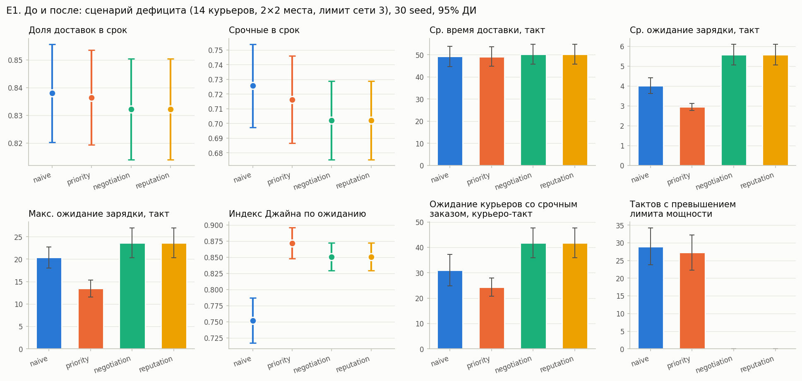
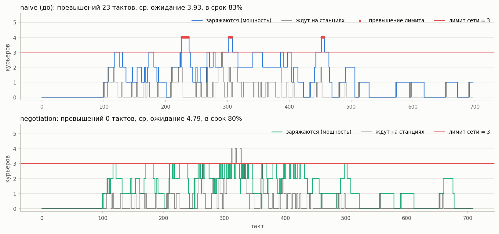
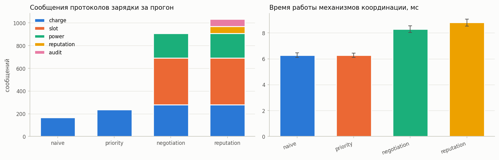
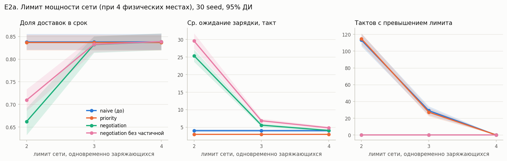
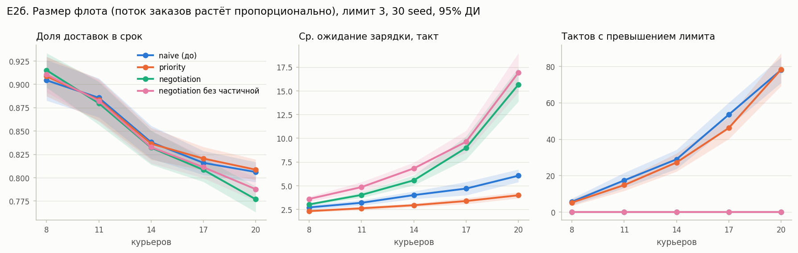
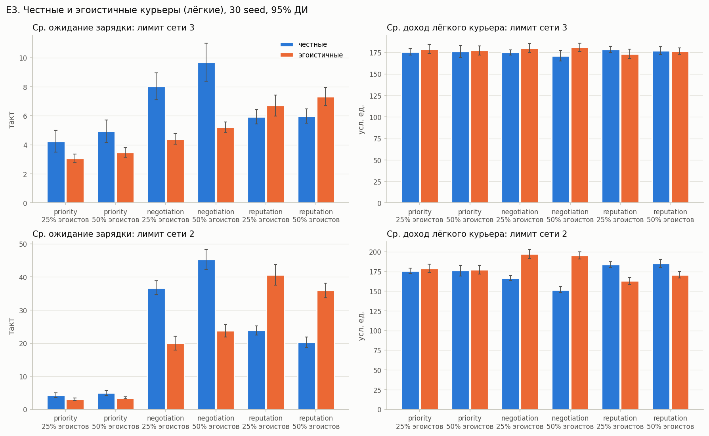

# 1. Цель работы

Цель работы — смоделировать в МАС «Городская доставка автономными курьерами» (ядро из ЛР1) конфликт
интересов за дефицитный ресурс, спроектировать и запрограммировать механизм его разрешения
(протокол переговоров, правила приоритезации, арбитраж, санкции и репутацию) и экспериментально
сравнить поведение системы до и после введения механизма по трём группам показателей:
эффективность, справедливость распределения и соблюдение общесистемных ограничений.

Механизм реализован как набор подключаемых режимов зарядки (`priority`, `negotiation`, `reputation`)
без изменения ядра. Стратегии курьеров и политики станций наследуются от базовых классов ядра.
Новые агенты (энергокоординатор сети и реестр репутации) добавляются в симуляцию при установке режима.
Новые роли и протоколы вносятся в таблицу полномочий ядра. Логика переговоров, арбитража и репутации
написана явно и выполняется только через сообщения шины. Готовые MAS-фреймворки не использовались.

# 2. Модель конфликта

## 2.1. Дефицитный ресурс и стороны конфликта

Ресурсов два, и оба общие для всех курьеров.

1. **Места на зарядных станциях.** У каждой станции ограниченное число мест; на одном месте
   одновременно заряжается один курьер.
2. **Мощность городской сети.** Это общесистемное ограничение: одновременно заряжаться могут не более
   L курьеров (параметр `grid_power_limit`), даже если физических мест больше. Метрика ядра
   «такты с превышением мощности» считает такты, в которые заряжается больше L курьеров.

Интересы сторон:

| Сторона | Чего хочет | Чем это мешает другим |
|---|---|---|
| Курьер | зарядиться сразу, на ближайшей станции и до полного заряда, чтобы скорее вернуться к заказам и заработать | занимает место и мощность дольше, чем нужно для его заказов; все едут на ближайшую станцию |
| Курьер со срочным заказом или почти разряженный | пройти без очереди | при обслуживании в порядке прибытия ждёт наравне со всеми и опаздывает |
| Станция | обслужить всех, не превышая число мест | не знает о загрузке соседней станции и о лимите сети |
| Сеть (система в целом) | не превышать лимит мощности, доставлять в срок, распределять ожидание справедливо | — |
| Эгоистичный курьер (если он есть) | получить приоритет обманом: занизить заряд, завысить срочность, забронировать всё, не уходить по квоте | вытесняет честных и искажает оценки ожидания |

## 2.2. Режим «до»: `charging=naive`

Базовый режим ядра не содержит переговоров. Курьер, которому не хватает энергии на текущий заказ и
дорогу до станции (или свободный курьер с зарядом ниже 40 %), едет на **ближайшую** станцию и просит место.
Станция обслуживает в **порядке прибытия** (FIFO), курьер заряжается до 95 % ёмкости. Лимит мощности сети
никто не координирует: станции не знают друг о друге, поэтому при пиковом спросе лимит нарушается.
Срочность заказа и остаток заряда при обслуживании не учитываются.

## 2.3. Сценарий дефицита и обоснование выбора

| Параметр | Значение | Зачем |
|---|---|---|
| Курьеров | 14 (2 тяжёлых, 12 лёгких) | почти вдвое больше, чем в базовом сценарии ЛР1: одновременный спрос на зарядку |
| Заказов, интенсивность | 150, 0,35 заказа за такт | повышенный поток: курьеры почти всё время в работе и чаще разряжаются |
| Станций × мест | 2 × 2 (4 физических места) | мест мало относительно флота |
| Скорость зарядки | 5 единиц за такт (в ядре по умолчанию 10) | полная зарядка лёгкого курьера занимает около 15 тактов, сравнимо с длительностью заказа: зарядка становится заметной частью рабочего цикла, возникают очереди |
| Лимит мощности сети L | 3 одновременно заряжающихся | меньше числа физических мест (4): лимит выше среднего спроса, но ниже пикового |
| Распределение заказов | `central` (базовое ядра) | сравнение касается только зарядки |

Лимит выбран так, чтобы конфликт был пиковым. В режиме `naive` в среднем заряжаются 1,32 курьера,
но в 18 % тактов заряжаются трое и больше, а пиковая мощность почти в каждом прогоне равна 4, то есть лимит
нарушается. Курьеры расходуют в среднем 7,3 единицы энергии за такт, а сеть при L = 3 отдаёт до 15 единиц
за такт. Значит, ограничение выполнимо без потери пропускной способности, если сгладить пики. Более жёсткий
лимит L = 2 (10 единиц за такт, загрузка сети около 73 %) исследован отдельно в эксперименте E2 как глубокий
дефицит, при котором спрос близок к пропускной способности сети. Конфликт в режиме `naive` заметен по всем
трём признакам, которых требует задание: в 24 % тактов кто-то ждёт у станции (максимальное ожидание в
среднем 20 тактов), лимит мощности нарушается в среднем 29 тактов за прогон, и 27 % срочных заказов
доставляются с опозданием.

# 3. Механизм разрешения конфликта

Механизм строится по нарастающей: каждый следующий режим включает предыдущий.

| Режим | Приоритеты и частичная зарядка | Переговоры о слоте и бронь | Арбитр мощности (лимит сети) | Репутация и санкции |
|---|---|---|---|---|
| `naive` (до) | — | — | — | — |
| `priority` | да | — | — | — |
| `negotiation` | да | да | да | — |
| `reputation` | да | да | да | да |

## 3.1. Роли и полномочия

К четырём ролям ядра (клиент, диспетчер, курьер, станция) добавлены две новые. Полномочия станции и
курьера расширены.

| Роль | Новые обязанности | Полномочия |
|---|---|---|
| Курьер | сообщает заявку о своём состоянии; ведёт переговоры о слоте; выбирает станцию по предложениям; уходит по квоте | выбирать станцию, принимать или отклонять предложения |
| Станция | упорядочивает очередь по критичности; ограничивает зарядку квотой; оценивает ожидание и выдаёт брони; запрашивает токен мощности; измеряет заряд подключённой батареи; сообщает наблюдения реестру; применяет санкции | распоряжаться своими местами, прерывать зарядку пересидевшего курьера, отказывать в брони |
| Энергокоординатор сети (новая роль `grid`) | выдаёт и принимает токены мощности, разрешает конфликт запросов по критичности, сообщает станциям их долю лимита и наличие дефицита | разрешать или откладывать начало зарядки на любой станции |
| Реестр репутации (новая роль `reputation`) | сверяет заявки с измерениями станций и книгой диспетчера, ведёт репутацию, рассылает её станциям | назначать санкции |
| Диспетчер | отвечает реестру, какие заказы закреплены за курьером (аудит) | — |

Новые протоколы внесены в таблицу полномочий ядра: `slot` (курьер ↔ станция), `power` (станция ↔
энергокоординатор), `reputation` (станция ↔ реестр), `audit` (реестр ↔ диспетчер). Протокол ядра `charge`
используется с расширенным содержимым: заявкой курьера и событиями «квота» и «выселение».

## 3.2. Заявка курьера

Прибыв на станцию (а также в начале переговоров), курьер отправляет **заявку**:

| Поле | Как его вычисляет честный курьер |
|---|---|
| заряд, ёмкость | текущее показание датчика батареи |
| потребность в энергии | энергия на весь оставшийся маршрут по принятым заказам, плюс путь от последней точки до ближайшей станции, плюс резерв 10 % ёмкости (не больше ёмкости) |
| ближайший срок | минимальный срок среди принятых заказов (нет заказов — пусто) |
| срочность | есть ли среди принятых заказов срочный |
| остаток маршрута | длина оставшегося маршрута в клетках |
| положение | клетка, где находится курьер (только в переговорах) |

## 3.3. Правила приоритезации

Станция обслуживает ожидающих в порядке убывания **критичности**:

P = доверие × (1,0 × D + 2,0 × U + 0,5 × S) + 1,0 × (ожидание / 20) + 1,0 × B.

| Слагаемое | Смысл | Значение |
|---|---|---|
| D — опустошённость батареи | чем меньше заряд, тем выше риск разрядки | 1 − заряд / ёмкость |
| U — близость срока | сколько времени остаётся до срока самого срочного заказа после остатка маршрута | 1 − (срок − текущий такт − остаток маршрута) / 40, обрезается до [0; 1]; нет заказов — 0 |
| S — срочный заказ | среди принятых есть заказ с приоритетом urgent | 0 или 1 |
| ожидание / 20 — старение | +1 за каждые 20 тактов ожидания: защита от бесконечного ожидания курьеров с низкой критичностью | растёт без ограничения |
| B — бронь | курьер прибыл по действующей брони (режимы с переговорами) | 0 или 1 |
| доверие | насколько станция верит заявке | 1 в `priority` и `negotiation`; в `reputation` — репутация курьера r, если r ≥ 0,5, иначе 0 |

Веса подобраны так, чтобы срочность заказа была важнее заряда (заряд и так учтён решением курьера
ехать на зарядку), а 20–40 тактов ожидания перевешивали любую заявку.

## 3.4. Частичная зарядка (квота)

Если на станции кто-то ждёт (или энергокоординатор сообщил о дефиците мощности в сети), заряжающемуся
курьеру выделяется только **квота**: потребность плюс 15 % ёмкости, но не меньше 50 % и не больше 95 % ёмкости.
Станция сама измеряет заряд подключённой батареи и, когда он достигает квоты, отправляет курьеру
INFORM {событие: квота}. Честный курьер заканчивает зарядку и уезжает, эгоистичный игнорирует уведомление.
Если очереди нет, курьер, как и в `naive`, заряжается до 95 %.

## 3.5. Протокол переговоров о слоте (режимы `negotiation`, `reputation`)

Когда курьеру пора заряжаться, он не едет сразу на ближайшую станцию, а проводит переговоры по схеме,
близкой к контрактной сети:

| Шаг | Отправитель → получатель | Перформатив, протокол | Содержимое и действие |
|---|---|---|---|
| 1 | курьер → все доступные станции | CFP, slot | заявка и положение. Пока идут переговоры, курьер без посылки едет к ближайшей станции (курьер с посылкой продолжает доставку), чтобы не забрать новую посылку и не повезти её на зарядку |
| 2 | станция → курьер | PROPOSE, slot | ожидаемый такт прибытия, ожидаемое ожидание и такт начала зарядки |
|   | станция → курьер | REFUSE, slot | станция недоступна или (в `reputation`) курьер лишён права брони |
| 3 | курьер | — | ждёт ответы всех станций, но не дольше 3 тактов; отбрасывает станции, до которых не хватит заряда; выбирает минимум суммы «путь до станции + ожидаемое ожидание + путь от станции до следующей точки маршрута» |
| 4 | курьер → выбранная станция | ACCEPT-PROPOSAL, slot | ожидаемый такт прибытия; курьер едет к станции |
|   | курьер → остальные станции | REJECT-PROPOSAL, slot | — |
| 5 | станция → курьер | INFORM, slot | бронь с окном от такта прибытия до такта прибытия + 4 |
| 6 | курьер → станция | REQUEST, charge | курьер прибыл, свежая заявка; бронь, по которой курьер прибыл вовремя, даёт надбавку B к критичности |
| 7 | станция → курьер | INFORM, charge | поставлен в очередь (номер в очереди) |
| 8 | станция → курьер | AGREE, charge | место и мощность выделены, зарядка началась |
| 9 | станция → курьер | INFORM, charge {квота} | квота набрана, просьба освободить место |
| 10 | курьер → станция | INFORM, charge {готово} | зарядка закончена, место освобождено |

Состояния брони на станции:

| Состояние | Переход |
|---|---|
| предложение отправлено | ACCEPT от курьера → «забронировано»; REJECT → бронь не создаётся |
| забронировано | курьер прибыл до конца окна → «погашена» (курьер в очереди с надбавкой B) |
| забронировано | окно истекло без прибытия → «истекла»: станция снимает бронь, шлёт курьеру INFORM {истекла}, в `reputation` сообщает реестру о неявке |
| забронировано | CANCEL от курьера → «отменена» |

Курьер, получивший по дороге уведомление об истечении брони, проводит переговоры заново (перезапрос).
Если вести переговоры некогда (заряда едва хватает до ближайшей станции), ни одна станция не прислала
предложение или курьер доехал до станции раньше, чем закончились переговоры, он встаёт в очередь без брони.

**Оценка ожидания станцией.** Станция строит своё расписание явно. Для каждого места вычисляется такт
освобождения: оставшаяся до квоты энергия заряжающегося, делённая на скорость зарядки. Число одновременно
работающих мест ограничено долей лимита сети, которую станции сообщает энергокоординатор (при L = 3 и двух
станциях по 2 места — по 2 места, при L = 2 — по одному). Затем в порядке прибытия в расписание ставятся
уже ожидающие и курьеры, забронировавшие прибытие раньше нового; длительность их зарядки оценивается по их
заявкам. Ожидание нового курьера — разность между тактом, когда после его прибытия освободится первое место,
и тактом прибытия. Благодаря броням два курьера, одновременно выбирающие станцию, не едут оба на одну:
второй видит в расписании бронь первого.

## 3.6. Арбитраж мощности: энергокоординатор сети

Станция не может начать зарядку без **токена мощности**; токенов ровно L. Протокол `power`:

| Сообщение | Смысл |
|---|---|
| станция → координатор: REQUEST {номер запроса, критичность} | на станции есть ожидающий курьер и свободное место |
| координатор → станция: AGREE {номер запроса} | токен выдан; станция ставит на место самого критичного из своих ожидающих |
| станция → координатор: CANCEL {номер запроса} | ожидающий ушёл, запрос больше не нужен |
| станция → координатор: INFORM {возврат} | зарядка закончилась (или курьер выселен), токен возвращён |
| координатор → станция: INFORM {доля} | доля лимита для оценок ожидания (в начале работы) |
| координатор → станция: INFORM {дефицит: да/нет} | есть неудовлетворённые запросы; на станциях с токенами включается квота |

**Правило арбитража.** Каждый такт координатор, пока есть свободные токены, выдаёт токен запросу с
максимальной оценкой «критичность из запроса + (текущий такт − такт запроса) / 20». Так при конфликте станций
мощность получает самый критичный курьер в сети, а старение не даёт станции с некритичными курьерами ждать
бесконечно. Станция занимает место только после получения токена и возвращает токен только после
освобождения места, поэтому число заряжающихся никогда не превышает L.

**Предзапрос по брони.** Обмен с координатором добавляет к ожиданию два такта задержки сообщений. Чтобы
бронь давала реальный выигрыш, станция запрашивает токен для забронировавшего курьера за два такта до его
ожидаемого прибытия. Курьер, прибывший вовремя, получает место так же быстро, как в режиме `naive`.
Если к моменту получения токена на станции уже ждёт другой курьер, токен получает самый критичный из
присутствующих; лишний токен сразу возвращается координатору.

## 3.7. Репутация и санкции (режим `reputation`)

Реестр репутации хранит для каждого курьера оценку r от 0 до 1 (в начале 1) и меняет её по наблюдениям.

| Наблюдение (кто и как обнаруживает) | Условие нарушения | Изменение r |
|---|---|---|
| Ложный заряд: при подключении станция измеряет заряд своим датчиком и сообщает его реестру вместе с заявкой | измеренный заряд больше заявленного более чем на 2 единицы | −0,3 |
| Ложная срочность: реестр запрашивает у диспетчера (QUERY, audit) заказы, закреплённые за курьером; диспетчер отвечает по своей книге заказов (INFORM, audit) | заявлен срочный заказ, которого нет, или заявленный срок раньше фактического более чем на 5 тактов | −0,3 (вместе с ложным зарядом — одна санкция за сеанс) |
| Пересиживание: курьер не ушёл через 3 такта после уведомления о квоте | станция отключает зарядку (выселяет курьера, освобождает место и токен) и сообщает реестру | −0,2 |
| Неявка: бронь истекла без прибытия и без отмены | станция сообщает реестру | −0,15 |
| Честный сеанс | проверки заявки не выявили лжи | +0,05 (не выше 1) |

Каждое изменение r реестр рассылает всем станциям (INFORM, reputation), станции хранят локальную копию.
**Санкции** ступенчатые. Доверие к заявке равно r: на него умножается заявочная часть критичности и
заявленная потребность при расчёте квоты. При r < 0,5 заявка не учитывается вовсе (приоритет курьера
определяется только старением), квота считается по нижней границе 50 % ёмкости, а в брони курьеру отказывают
(REFUSE {репутация}), и он может заряжаться только без брони.

## 3.8. Модель эгоистичного курьера

Эгоистичные курьеры включаются параметром `selfish_share` (доля флота). Они выбираются среди лёгких курьеров
равномерно по списку, одинаково для всех режимов и seed, чтобы сравнение групп не искажалось типом курьера:
у тяжёлых другая батарея и другие заказы. Код курьера тот же, отличается только флаг поведения.

| Вид нечестности (параметр) | Что делает эгоист |
|---|---|
| ложная заявка (`selfish_lie`) | заявляет заряд в 0,3 от фактического, потребность, равную всей ёмкости, и срочный заказ со сроком «через такт» |
| пересиживание (`selfish_overstay`) | игнорирует уведомление о квоте и заряжается до 100 % |
| неявка (`selfish_noshow`) | принимает предложения всех станций (бронирует все), едет на одну, остальные брони не отменяет |

## 3.9. Пример переговоров по трассе

Фрагмент трассы реального прогона (режим `reputation`, seed 2, сценарий дефицита, 25 % эгоистов):
честный лёгкий курьер courier-12 без заказов, заряд 30 из 100.

| Такт | Сообщение | Содержимое |
|---|---|---|
| 161 | courier-12 → station-1, station-2: CFP, slot | заряд 30,2, потребность 20, срочных заказов нет; курьер направляется к ближайшей станции |
| 162 | station-1 → courier-12: PROPOSE | прибытие в такт 173, ожидание 0 |
| 162 | station-2 → courier-12: PROPOSE | прибытие в такт 184, ожидание 0 |
| 163 | courier-12 → station-1: ACCEPT; → station-2: REJECT | выбрана ближняя станция, прибытие в такт 171 |
| 164 | station-1 → courier-12: INFORM, slot | бронь до такта 175 |
| 169 | station-1 → grid: REQUEST, power | предзапрос токена для подъезжающего курьера, критичность 1,6 |
| 170 | grid → station-1: AGREE, power; courier-12 → station-1: REQUEST, charge | токен выдан; курьер прибыл с зарядом 20,2 |
| 171 | station-1 → courier-12: AGREE, charge | зарядка началась; ожидание 2 такта, это минимум из-за задержки сообщений |
| 185 | courier-12 → station-1: INFORM, charge {готово} | заряд 95,2 |
| 186 | station-1 → grid: INFORM {возврат} | токен возвращён координатору |

# 4. Методика экспериментов

Эксперименты запускаются одной командой `python lab3/experiments.py` (около 2,5 минуты). Каждый вариант
прогоняется на **одних и тех же 30 seed** (1–30). Поток заказов зависит только от seed, поэтому все режимы
получают одинаковые заказы (метод общих случайных чисел), и разность между режимами можно оценивать парно,
по каждому seed отдельно. Для всех показателей приводится среднее ± полуширина 95 % доверительного
интервала (1,96 · s / √n). Результаты по каждому прогону и сводки сохраняются в `lab3/results/*.csv`, графики —
в `lab3/figures/*.png`.

Показатели:

* **эффективность** — доля доставок в срок (всех и срочных), среднее время доставки, время выполнения
  всех заказов, среднее и максимальное ожидание зарядки (от прибытия на станцию до начала зарядки),
  суммарное время, которое курьеры со срочным заказом и с посылкой на борту провели в ожидании у станций;
* **справедливость** — индекс Джайна и коэффициент Джини по среднему ожиданию курьеров, индекс Джайна и
  коэффициент Джини по доходу, ожидание и доход честных и эгоистичных курьеров;
* **соблюдение ограничений** — число тактов с превышением лимита мощности, превышение в место-тактах,
  пиковая мощность, превышения числа мест на станции, разрядки в пути;
* **цена механизма** — сообщения протоколов зарядки (charge, slot, power, reputation, audit), процессорное
  время механизмов координации.

Физическую картину (сколько курьеров заряжается и ждёт в каждом такте, есть ли у ожидающих срочный заказ)
фиксирует наблюдатель эксперимента, одинаковый для всех режимов; агентам эти данные недоступны.

Эксперименты:

* **E1** — до и после: `naive`, `priority`, `negotiation`, `reputation` в сценарии дефицита.
* **E2** — степень дефицита: (а) лимит сети L = 2, 3, 4 при 4 физических местах; (б) размер флота
  8, 11, 14, 17, 20 курьеров при пропорциональном потоке заказов (0,025 заказа за такт на курьера) и L = 3.
  Кроме режимов `naive`, `priority`, `negotiation`, здесь прогоняется `negotiation` с отключённой частичной
  зарядкой (параметр `partial_charge=False`), чтобы отделить вклад квоты.
* **E3** — эгоистичные курьеры: доля 0, 25 и 50 % в режимах `priority`, `negotiation`, `reputation`
  при L = 3 и при глубоком дефиците L = 2.

# 5. Результаты

## 5.1. E1: до и после введения механизма

Таблица 1 — E1, сценарий дефицита (14 курьеров, 2 × 2 места, L = 3), среднее ± 95 % ДИ по 30 seed

| Показатель | naive (до) | priority | negotiation | reputation |
|---|---:|---:|---:|---:|
| Доля доставок в срок | 0,838 ± 0,018 | 0,836 ± 0,017 | 0,832 ± 0,018 | 0,832 ± 0,018 |
| Срочные в срок | 0,726 ± 0,028 | 0,716 ± 0,030 | 0,702 ± 0,027 | 0,702 ± 0,027 |
| Ср. время доставки, такт | 49,3 ± 4,6 | 49,2 ± 4,4 | 50,3 ± 4,4 | 50,3 ± 4,4 |
| Время выполнения всех заказов, такт | 639 ± 30 | 635 ± 29 | 639 ± 29 | 639 ± 29 |
| Сеансов зарядки | 51,0 ± 0,8 | 55,4 ± 1,3 | 61,4 ± 2,0 | 61,4 ± 2,0 |
| Ср. ожидание зарядки, такт | 4,02 ± 0,40 | 2,95 ± 0,18 | 5,57 ± 0,52 | 5,57 ± 0,52 |
| Макс. ожидание зарядки, такт | 20,4 ± 2,3 | 13,5 ± 1,9 | 23,7 ± 3,3 | 23,7 ± 3,3 |
| Ожидание курьеров со срочным заказом, курьеро-такт | 31,1 ± 6,2 | 24,4 ± 3,7 | 41,9 ± 5,9 | 41,9 ± 5,9 |
| Ожидание курьеров с посылкой на борту, курьеро-такт | 0 | 0 | 0 | 0 |
| Индекс Джайна по ожиданию | 0,752 ± 0,035 | 0,872 ± 0,024 | 0,851 ± 0,021 | 0,851 ± 0,021 |
| Джини по ожиданию | 0,284 ± 0,024 | 0,185 ± 0,020 | 0,223 ± 0,019 | 0,223 ± 0,019 |
| Индекс Джайна по доходу | 0,844 ± 0,018 | 0,846 ± 0,019 | 0,850 ± 0,019 | 0,850 ± 0,019 |
| Тактов с превышением лимита мощности | 29,0 ± 5,3 | 27,3 ± 5,0 | 0 | 0 |
| Пиковая мощность (заряжаются одновременно) | 3,97 ± 0,07 | 4,00 ± 0,00 | 3,00 ± 0,00 | 3,00 ± 0,00 |
| Средняя мощность | 1,32 ± 0,05 | 1,33 ± 0,05 | 1,32 ± 0,05 | 1,32 ± 0,05 |
| Превышений числа мест, разрядок в пути | 0 | 0 | 0 | 0 |
| Суммарный пробег, клеток | 3572 ± 41 | 3612 ± 43 | 3657 ± 56 | 3657 ± 56 |
| Сообщений протоколов зарядки за прогон | 166 ± 3 | 237 ± 7 | 907 ± 34 | 1033 ± 39 |
| Сообщений зарядки на сеанс | 3,2 | 4,3 | 14,8 | 16,8 |
| Сообщений всего | 3013 ± 85 | 3074 ± 83 | 3752 ± 89 | 3878 ± 92 |
| CPU механизмов координации, мс за прогон | 6,1 ± 0,2 | 6,0 ± 0,2 | 8,1 ± 0,3 | 8,5 ± 0,2 |
| Остановок по квоте | — | 14,4 ± 1,8 | 32,0 ± 3,8 | 32,0 ± 3,8 |
| Броней | — | — | 55,7 ± 1,9 | 55,7 ± 1,9 |
| Ожидание токена у энергокоординатора, такт | — | — | 0,78 ± 0,15 | 0,78 ± 0,15 |
| Ложных обвинений честных курьеров | — | — | — | 0 |

Таблица 2 — E1, парные разности «режим − naive» по одинаковым seed (среднее ± 95 % ДИ)

| Разность с naive | priority | negotiation и reputation |
|---|---:|---:|
| Доля доставок в срок | −0,002 ± 0,005 | −0,006 ± 0,005 |
| Срочные в срок | −0,009 ± 0,018 | −0,024 ± 0,019 |
| Ср. время доставки, такт | −0,05 ± 0,54 | +0,99 ± 0,96 |
| Ср. ожидание зарядки, такт | −1,07 ± 0,31 | +1,56 ± 0,49 |
| Макс. ожидание зарядки, такт | −6,9 ± 2,2 | +3,3 ± 3,5 |
| Индекс Джайна по ожиданию | +0,120 ± 0,031 | +0,099 ± 0,039 |
| Ожидание курьеров со срочным заказом, курьеро-такт | −6,7 ± 6,0 | +10,8 ± 5,9 |
| Тактов с превышением лимита | −1,7 ± 4,9 | −29,0 ± 5,3 |

## 5.2. E2: степень дефицита

Таблица 3 — E2а, лимит мощности сети (среднее ± 95 % ДИ). Режимы `naive` и `priority` от лимита не зависят:
они его не соблюдают, лимит влияет только на счётчик превышений.

| Показатель | Режим | L = 2 | L = 3 | L = 4 |
|---|---|---:|---:|---:|
| Доля доставок в срок | naive | 0,838 ± 0,018 | 0,838 ± 0,018 | 0,838 ± 0,018 |
|  | priority | 0,836 ± 0,017 | 0,836 ± 0,017 | 0,836 ± 0,017 |
|  | negotiation | 0,662 ± 0,030 | 0,832 ± 0,018 | 0,838 ± 0,019 |
|  | negotiation без частичной зарядки | 0,710 ± 0,024 | 0,833 ± 0,017 | 0,839 ± 0,018 |
| Срочные в срок | naive | 0,726 ± 0,028 | 0,726 ± 0,028 | 0,726 ± 0,028 |
|  | negotiation | 0,497 ± 0,039 | 0,702 ± 0,027 | 0,722 ± 0,031 |
|  | negotiation без частичной зарядки | 0,570 ± 0,043 | 0,706 ± 0,025 | 0,715 ± 0,029 |
| Ср. ожидание зарядки, такт | naive | 4,02 ± 0,40 | 4,02 ± 0,40 | 4,02 ± 0,40 |
|  | priority | 2,95 ± 0,18 | 2,95 ± 0,18 | 2,95 ± 0,18 |
|  | negotiation | 25,38 ± 1,74 | 5,57 ± 0,52 | 4,06 ± 0,26 |
|  | negotiation без частичной зарядки | 29,59 ± 2,19 | 6,83 ± 0,62 | 4,81 ± 0,37 |
| Макс. ожидание зарядки, такт | naive | 20,4 ± 2,3 | 20,4 ± 2,3 | 20,4 ± 2,3 |
|  | negotiation | 79,4 ± 4,8 | 23,7 ± 3,3 | 18,7 ± 2,6 |
|  | negotiation без частичной зарядки | 82,3 ± 5,0 | 32,4 ± 3,1 | 24,6 ± 3,4 |
| Индекс Джайна по ожиданию | naive | 0,752 ± 0,035 | 0,752 ± 0,035 | 0,752 ± 0,035 |
|  | negotiation | 0,888 ± 0,012 | 0,851 ± 0,021 | 0,841 ± 0,027 |
|  | negotiation без частичной зарядки | 0,879 ± 0,020 | 0,769 ± 0,026 | 0,777 ± 0,029 |
| Сеансов зарядки | negotiation | 67,1 ± 1,4 | 61,4 ± 2,0 | 55,8 ± 1,3 |
|  | negotiation без частичной зарядки | 51,5 ± 0,9 | 50,4 ± 0,8 | 50,7 ± 0,7 |
| Тактов с превышением лимита | naive | 113,2 ± 7,5 | 29,0 ± 5,3 | 0 |
|  | priority | 114,7 ± 6,6 | 27,3 ± 5,0 | 0 |
|  | negotiation (оба варианта) | 0 | 0 | 0 |

Таблица 4 — E2б, размер флота (среднее ± 95 % ДИ)

| Показатель | Режим | 8 | 11 | 14 | 17 | 20 |
|---|---|---:|---:|---:|---:|---:|
| Доля доставок в срок | naive | 0,904 ± 0,022 | 0,886 ± 0,021 | 0,838 ± 0,018 | 0,816 ± 0,013 | 0,806 ± 0,011 |
|  | priority | 0,908 ± 0,021 | 0,883 ± 0,022 | 0,836 ± 0,017 | 0,821 ± 0,013 | 0,809 ± 0,011 |
|  | negotiation | 0,915 ± 0,018 | 0,880 ± 0,023 | 0,832 ± 0,018 | 0,808 ± 0,013 | 0,777 ± 0,014 |
|  | negotiation без частичной зарядки | 0,910 ± 0,019 | 0,882 ± 0,022 | 0,833 ± 0,017 | 0,811 ± 0,012 | 0,788 ± 0,013 |
| Ср. ожидание зарядки, такт | naive | 2,72 ± 0,28 | 3,21 ± 0,29 | 4,02 ± 0,40 | 4,70 ± 0,71 | 6,06 ± 0,67 |
|  | priority | 2,33 ± 0,11 | 2,62 ± 0,20 | 2,95 ± 0,18 | 3,39 ± 0,32 | 4,00 ± 0,31 |
|  | negotiation | 3,04 ± 0,10 | 4,03 ± 0,30 | 5,57 ± 0,52 | 9,00 ± 1,21 | 15,66 ± 1,78 |
| Ожидание курьеров со срочным заказом, курьеро-такт | naive | 12,4 ± 3,3 | 17,2 ± 3,7 | 31,1 ± 6,2 | 52,7 ± 10,4 | 87,2 ± 13,1 |
|  | priority | 9,9 ± 2,0 | 15,4 ± 2,4 | 24,4 ± 3,7 | 37,0 ± 4,4 | 49,1 ± 5,9 |
|  | negotiation | 11,8 ± 2,5 | 25,1 ± 4,0 | 41,9 ± 5,9 | 74,9 ± 13,6 | 160,8 ± 36,8 |
| Индекс Джайна по ожиданию | naive | 0,895 ± 0,028 | 0,823 ± 0,030 | 0,752 ± 0,035 | 0,754 ± 0,033 | 0,755 ± 0,022 |
|  | priority | 0,958 ± 0,019 | 0,921 ± 0,028 | 0,872 ± 0,024 | 0,850 ± 0,025 | 0,815 ± 0,024 |
|  | negotiation | 0,920 ± 0,017 | 0,870 ± 0,022 | 0,851 ± 0,021 | 0,828 ± 0,021 | 0,848 ± 0,018 |
| Тактов с превышением лимита | naive | 5,7 ± 1,8 | 17,4 ± 4,2 | 29,0 ± 5,3 | 53,5 ± 6,6 | 78,0 ± 7,1 |
|  | priority | 5,3 ± 1,8 | 14,9 ± 3,2 | 27,3 ± 5,0 | 46,2 ± 6,0 | 78,3 ± 9,0 |
|  | negotiation (оба варианта) | 0 | 0 | 0 | 0 | 0 |

Разрядок в пути и превышений числа мест не было ни в одном прогоне E2.

## 5.3. E3: эгоистичные курьеры

Таблица 5 — E3 при L = 3 (группы сравниваются по лёгким курьерам; «выигрыш эгоиста» — парная разность
внутри прогона: ожидание честных минус ожидание эгоистов, доход эгоистов минус доход честных)

| Режим, доля эгоистов | Ожидание честных, такт | Ожидание эгоистов, такт | Выигрыш эгоиста по ожиданию, такт | Выигрыш эгоиста по доходу | Доля в срок |
|---|---:|---:|---:|---:|---:|
| priority, 0 % | 3,11 ± 0,21 | — | — | — | 0,836 ± 0,017 |
| priority, 25 % | 4,25 ± 0,75 | 3,07 ± 0,31 | +1,18 ± 0,66 | +3,3 ± 7,3 | 0,836 ± 0,017 |
| priority, 50 % | 4,94 ± 0,78 | 3,47 ± 0,33 | +1,47 ± 0,73 | +1,1 ± 11,3 | 0,834 ± 0,017 |
| negotiation, 0 % | 6,09 ± 0,60 | — | — | — | 0,832 ± 0,018 |
| negotiation, 25 % | 8,03 ± 0,91 | 4,41 ± 0,36 | +3,61 ± 0,94 | +5,1 ± 6,5 | 0,829 ± 0,017 |
| negotiation, 50 % | 9,69 ± 1,31 | 5,22 ± 0,35 | +4,47 ± 1,23 | +9,9 ± 9,6 | 0,831 ± 0,017 |
| reputation, 0 % | 6,09 ± 0,60 | — | — | — | 0,832 ± 0,018 |
| reputation, 25 % | 5,92 ± 0,50 | 6,71 ± 0,72 | −0,78 ± 0,56 | −5,2 ± 7,7 | 0,831 ± 0,018 |
| reputation, 50 % | 5,98 ± 0,50 | 7,32 ± 0,62 | −1,33 ± 0,72 | −0,4 ± 6,5 | 0,825 ± 0,016 |

Таблица 6 — E3 при глубоком дефиците L = 2 (режим `priority` лимит не соблюдает, его результаты совпадают с L = 3)

| Режим, доля эгоистов | Ожидание честных, такт | Ожидание эгоистов, такт | Выигрыш эгоиста по ожиданию, такт | Доход честных | Доход эгоистов | Выигрыш эгоиста по доходу | Доля в срок |
|---|---:|---:|---:|---:|---:|---:|---:|
| negotiation, 0 % | 28,80 ± 1,90 | — | — | 176,9 ± 2,6 | — | — | 0,662 ± 0,030 |
| negotiation, 25 % | 36,73 ± 2,08 | 20,04 ± 2,09 | +16,69 ± 1,98 | 166,8 ± 3,2 | 197,2 ± 5,7 | +30,4 ± 6,9 | 0,666 ± 0,030 |
| negotiation, 50 % | 45,32 ± 2,97 | 23,78 ± 1,87 | +21,54 ± 2,28 | 151,9 ± 3,9 | 195,2 ± 4,5 | +43,3 ± 6,8 | 0,679 ± 0,024 |
| reputation, 25 % | 23,86 ± 1,38 | 40,66 ± 3,08 | −16,80 ± 2,07 | 183,7 ± 3,7 | 163,1 ± 4,4 | −20,6 ± 6,4 | 0,672 ± 0,031 |
| reputation, 50 % | 20,29 ± 1,54 | 35,94 ± 2,19 | −15,65 ± 1,89 | 185,1 ± 5,4 | 170,9 ± 4,1 | −14,2 ± 8,0 | 0,667 ± 0,027 |

Таблица 7 — Работа реестра репутации (среднее за прогон ± 95 % ДИ)

| Условия | Выявлено ложных заявок | Выселений за пересиживание | Неявок по брони | Отказов в брони | Итоговая репутация эгоистов | Ложных обвинений честных |
|---|---:|---:|---:|---:|---:|---:|
| L = 3, 25 % эгоистов | 14,6 ± 0,8 | 6,0 ± 1,1 | 5,1 ± 0,5 | 14,3 ± 1,8 | 0,02 ± 0,01 | 0 |
| L = 3, 50 % эгоистов | 26,3 ± 1,3 | 12,7 ± 1,8 | 9,4 ± 0,6 | 26,2 ± 3,0 | 0,01 ± 0,01 | 0 |
| L = 2, 25 % эгоистов | 17,3 ± 0,5 | 12,6 ± 0,6 | 4,8 ± 0,4 | 21,5 ± 1,3 | 0,00 | 0 |
| L = 2, 50 % эгоистов | 32,8 ± 1,3 | 26,1 ± 1,3 | 8,3 ± 0,5 | 42,7 ± 2,8 | 0,00 | 0 |

Без реестра (режим `negotiation`) неявок по брони за прогон было 9,1 ± 0,9 и 16,1 ± 1,0 при L = 3 и
10,6 ± 0,8 и 17,9 ± 1,0 при L = 2 (25 % и 50 % эгоистов соответственно); с реестром неявок примерно вдвое
меньше, потому что после первых нарушений эгоистам отказывают в брони.

# 6. Анализ

## 6.1. Соблюдение общесистемных ограничений

Главный результат механизма — **лимит мощности сети соблюдается всегда**. В режимах `negotiation` и `reputation`
не было ни одного такта с превышением ни в одном из 900 прогонов с арбитром во всех экспериментах (в том
числе при L = 2 и при 20 курьерах), пиковая мощность равна лимиту. Это следует из устройства арбитража:
станция занимает место только по токену, а токенов ровно L. В режиме «до» лимит нарушался 29 тактов за прогон
в основном сценарии, 113 тактов (около 18 % времени работы) при L = 2 и 78 тактов при 20 курьерах.
Одни правила приоритезации (`priority`) ограничение не решают: станции не знают друг о друге, и превышения
остаются на уровне `naive` (27 тактов, разница с naive статистически незначима). Для соблюдения
общесистемного ограничения нужен именно арбитр с полномочием на всю сеть. Превышений числа мест и
разрядок в пути не было ни в одном из 1 620 прогонов всех режимов.

## 6.2. Эффективность

**Приоритеты и квота (`priority`)** — чистый выигрыш по ожиданию без потерь в доставке. Среднее ожидание
зарядки снизилось на 27 % (с 4,02 до 2,95 такта), максимальное — на 34 % (с 20,4 до 13,5), время, которое
курьеры со срочным заказом проводят в очереди, — на 22 % (парная разность −6,7 ± 6,0 курьеро-такта). Доля
доставок в срок и время доставки не изменились (парные разности незначимы). Выигрыш даёт в основном квота:
курьер, набравший энергию на свои заказы, уступает место, поэтому очереди короче, хотя сеансов становится больше
(55 вместо 51). Ограничение сети `priority` при этом нарушает.

**Переговоры с арбитром (`negotiation`)** соблюдают лимит, и за это приходится платить. В основном сценарии
(L = 3) среднее ожидание выросло на 1,56 ± 0,49 такта (+39 %), доля доставок в срок снизилась на
0,6 ± 0,5 процентного пункта, доля срочных в срок — на 2,4 ± 1,9 п. п., среднее время доставки выросло на 1,0 такта
(на границе значимости). Причина в том, что лимит отнимает у системы четвёртое место в пиках: в 18 % тактов
сеть работает на лимите, и курьер, который в `naive` встал бы на четвёртое место, теперь ждёт токен. Это видно на
рисунке 2: в `naive` мощность в пиках поднимается до 4, а в `negotiation` упирается в 3, и в эти моменты растёт
число ожидающих. Механизм не создаёт пропускную способность, он лишь распределяет её. Квота, баланс между
станциями по предложениям и предзапрос токена по брони снижают цену соблюдения ограничения до малой
величины. Если же лимит не дефицитен (L = 4), `negotiation` не хуже `naive`: доля в срок 0,838 и 0,838,
ожидание 4,06 и 4,02, максимальное ожидание 18,7 и 20,4. Значит, накладные расходы самих переговоров
(задержка сообщений, перенаправления) почти нулевые.

**Где механизм хуже и почему.** Цена соблюдения лимита растёт с глубиной дефицита. При L = 2 сеть может отдать
10 единиц энергии за такт при потребности около 7,3, то есть загрузка около 73 % плюс накладные расходы.
Очереди за токенами становятся постоянными: ожидание 25,4 такта, доля в срок 0,662 против 0,838 у `naive`,
срочные в срок 0,497 против 0,726. С ростом флота до 20 курьеров при L = 3 доля в срок падает до 0,777 против
0,806 у `naive`. В этих режимах `naive` выглядит эффективнее только потому, что нарушает лимит (113 и 78 тактов
превышения). При глубоком дефиците вредит и частичная зарядка. Когда очередь не рассасывается, квота лишь
увеличивает число сеансов (67 вместо 51,5), а каждый сеанс начинается с долгого ожидания: без квоты доля в срок
0,710 против 0,662, срочные в срок 0,570 против 0,497. При умеренном дефиците (L = 3, L = 4) квота, наоборот,
полезна: среднее ожидание 5,57 против 6,83, максимальное 23,7 против 32,4, индекс Джайна 0,851 против 0,769
при одинаковой доле в срок. Отсюда практический вывод: квоту стоит включать при пиковом дефиците и
отключать при постоянном. Это можно сделать параметром или сделать квоту адаптивной (в работе не реализовано).

Приоритет срочным заказам в нашей модели почти не влияет на долю срочных доставок в срок, хотя время
ожидания курьеров со срочными заказами в `priority` заметно меньше. Опоздания определяются в основном
нагрузкой на флот и распределением заказов: диспетчер не знает об очередях у станций и продолжает назначать
заказы ожидающим курьерам, а ожидание зарядки составляет лишь несколько тактов из примерно 50 тактов
доставки. Механизм зарядки не может исправить это без участия механизма распределения (предмет ЛР2).

## 6.3. Справедливость

Все режимы с механизмом распределяют ожидание заметно равномернее, чем `naive`. Индекс Джайна по среднему
ожиданию курьеров вырос с 0,752 до 0,872 (`priority`) и 0,851 (`negotiation`), коэффициент Джини снизился с 0,284
до 0,185 и 0,223. В `naive` неравенство возникает из-за того, что курьеры, работающие у загруженной станции,
постоянно попадают в очередь, а остальные — нет. Старение в формуле критичности, выбор станции по оценке
ожидания и квота выравнивают ожидание. Справедливость по доходу практически не меняется (индекс Джайна
0,844–0,850): доход определяется распределением заказов, а не зарядкой.

Без защиты механизм переговоров уязвим для нечестных агентов, и уязвимость тем сильнее, чем глубже дефицит.
При L = 3 и 25 % эгоистов эгоист ждёт на 3,6 такта меньше честного, а честные ждут дольше, чем в полностью
честной системе (8,03 против 6,09). При L = 2 выигрыш эгоиста — 16,7 такта ожидания и 30,4 единицы дохода
(+18 %), а при 50 % эгоистов — 21,5 такта и 43,3 единицы (+28 %); доход честного курьера падает с 176,9 до 151,9.
В режиме `priority` выигрыш эгоиста мал (1,2–1,5 такта), потому что без лимита сети очереди короткие и обманом
почти нечего получить.

**Репутация меняет знак выигрыша:** при всех долях эгоистов и обоих лимитах эгоист ждёт дольше честного
(−0,8 и −1,3 такта при L = 3; −16,8 и −15,7 такта при L = 2), а при L = 2 и зарабатывает меньше (−20,6 и −14,2 единицы).
Ожидание честных курьеров возвращается к уровню честной системы (5,92–5,98 при L = 3 против 6,09) или становится
даже ниже (23,9 и 20,3 при L = 2 против 28,8): эгоистов с нулевой репутацией выселяют по квоте и обслуживают
только по старению. Реестр выявляет 14,6–32,8 ложных заявок за прогон, репутация эгоистов к
концу прогона падает до 0–0,02, а **честных курьеров реестр не обвинил ни разу** во всех 210 прогонах
с режимом `reputation`. На общую эффективность ни эгоисты, ни санкции заметно не влияют (доля в срок в пределах
доверительного интервала): конфликт с эгоистами — это в первую очередь вопрос справедливости распределения.

## 6.4. Цена механизма

Переговоры и арбитраж увеличивают число сообщений протоколов зарядки в 5,5 раза (907 против 166 за прогон,
14,8 сообщения на сеанс зарядки против 3,2): по 2 сообщения CFP, 2 ответа, 2 сообщения о выборе, подтверждение
брони, запрос, выдача и возврат токена. Общий трафик системы вырос на 25 % (3752 против 3013 сообщений), так как
большую его часть составляют телеметрия и назначения заказов. Реестр репутации добавляет ещё около 126 сообщений
за прогон (наблюдения станций, аудит у диспетчера, рассылка репутации), то есть около 3 %. Процессорное время
механизмов координации выросло с 6,1 до 8,1–8,5 мс за прогон, что пренебрежимо мало. Пробег вырос на 2,4 %
(частичная зарядка увеличивает число поездок на станции, а выбор станции по ожиданию иногда ведёт к дальней).
Задержка сообщений при обмене с арбитром (два такта) почти полностью скрыта предзапросом токена по брони:
среднее ожидание токена у координатора — 0,78 такта.

## 6.5. Ограничения модели

* Станция измеряет заряд подключённой батареи своим датчиком, а диспетчер считается доверенным источником
  о заказах; без этих независимых источников ложь о заряде и срочности проверить было бы нельзя.
* Эгоисты действуют по фиксированной стратегии и не учатся. Адаптивный эгоист мог бы лгать умеренно, в пределах
  допусков проверок; это направление для развития.
* Веса формулы критичности, параметры квоты и штрафы репутации подобраны вручную, без оптимизации.
* Физика зарядки ядра не позволяет заряжать с пониженной мощностью, поэтому лимит сети соблюдается
  только ограничением числа одновременно заряжающихся.
* Механизм распределения заказов (`central`) не знает об очередях на станциях, поэтому эффект зарядки на
  доставку в срок ограничен.

# 7. Выводы

1. Смоделирован конфликт за два дефицитных общих ресурса: места на станциях и лимит мощности сети. В режиме
   «до» (`naive`: ближайшая станция, FIFO, зарядка до полного) конфликт проявляется очередями, неравномерным
   ожиданием (индекс Джайна 0,752) и нарушением общесистемного лимита мощности в среднем 29 тактов за прогон
   (113 при L = 2).
2. Реализованы три уровня механизма, все — явной логикой агентов и сообщениями шины: правила приоритезации по
   критичности со старением и частичной зарядкой (`priority`); протокол переговоров о слоте с предложениями,
   бронью, перезапросом и арбитром мощности — новой ролью энергокоординатора (`negotiation`); репутация и санкции
   с проверкой заявок по измерениям станций и книге диспетчера — новой ролью реестра репутации (`reputation`).
3. Ограничение выполнено полностью: с арбитром мощности лимит сети не превышен ни в одном прогоне, пиковая
   мощность равна лимиту. Одних локальных правил на станциях для этого недостаточно.
4. Эффективность: при умеренном дефиците цена соблюдения лимита мала (−0,6 п. п. доставок в срок, +1,6 такта
   ожидания), без дефицита мощности переговоры не хуже исходного режима. При глубоком дефиците (L = 2, большой
   флот) соблюдение лимита заметно снижает долю доставок в срок. Это цена ограничения, а не протокола, и
   частичную зарядку в таком режиме лучше отключать. Одни правила приоритезации сокращают ожидание на 27 %
   и максимальное ожидание на 34 % без потерь в доставке, но лимит сети не соблюдают.
5. Справедливость: механизм выравнивает ожидание (индекс Джайна 0,85–0,87 против 0,75). Без репутации эгоистичные
   курьеры выигрывают за счёт честных (при глубоком дефиците до +28 % дохода). Репутация и санкции делают обман
   невыгодным: эгоисты ждут дольше и зарабатывают меньше честных, честные курьеры ни разу не наказаны.
6. Цена механизма — в 5,5 раза больше сообщений протоколов зарядки (+25 % общего трафика) и несколько
   миллисекунд вычислений за прогон.

# Приложения

**Исходный код и материалы:** https://github.com/denvyworking/mo-labs. Код ЛР3 находится в папке `lab3/`:
`plugin.py` (регистрация режимов, ролей и протоколов), `common.py` (заявка, формула критичности, квота,
эгоистичные курьеры, показатели), `priority.py`, `negotiation.py`, `grid.py`, `reputation.py`, `modes.py`,
`experiments.py`; описание запуска и параметров — `lab3/README.md`. Результаты прогонов — `lab3/results/*.csv`,
графики — `lab3/figures/*.png`.

**Демонстрация:** веб-интерфейс ядра (`python lab1/web/server.py`) и консольный запуск (`python lab1/run.py`)
показывают режимы зарядки `priority`, `negotiation`, `reputation`, а также пресеты `negotiation-selfish` и
`reputation-selfish` (30 % эгоистичных курьеров) для демонстрации без задания параметров. Эксперименты
воспроизводятся командой `python lab3/experiments.py`.
